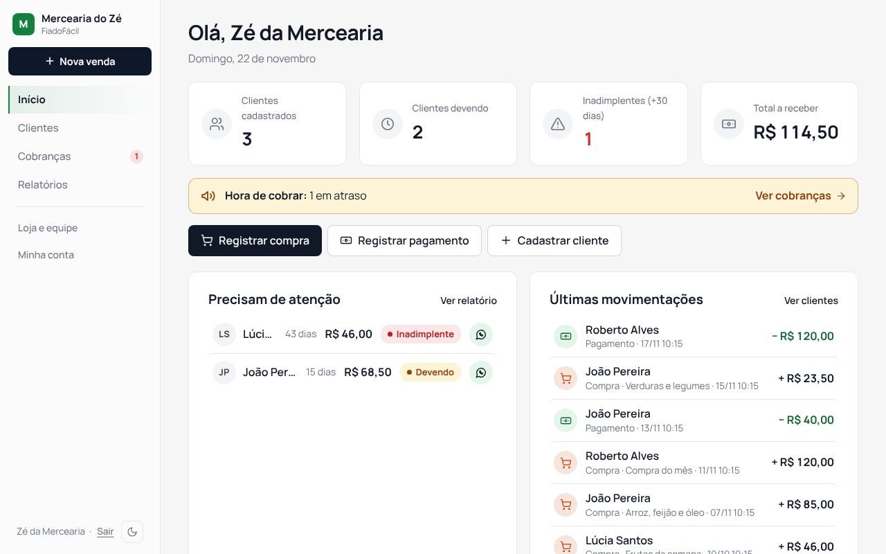

# FiadoFácil: sistema de controle de fiado

Sistema web que ajuda o pequeno comércio a controlar as vendas no fiado: compras a prazo, pagamentos e dívidas dos clientes, com relatórios, ranking de confiabilidade e uma área onde o cliente confere quanto deve.

🔗 **Site no ar:** https://fiadofacil.free.je (contas de teste mais abaixo) · **Site de teste:** https://fiadofacilteste.free.je

[](https://github.com/matheuswilton/Sistema-de-Fiado/actions/workflows/testes.yml)
[](https://github.com/matheuswilton/Sistema-de-Fiado/actions/workflows/snyk.yml)
[](https://github.com/matheuswilton/Sistema-de-Fiado/actions/workflows/deploy.yml)

Projeto Integrador do curso de Gestão da Tecnologia da Informação da FPM (Goiânia/GO), desenvolvido por **Matheus Wilton**.

## Resumo

- **Aplicação web com várias lojas (PHP 8 + MySQL):** as lojas dividem o mesmo banco com os dados totalmente separados, e o cliente tem uma conta única pelo CPF que mostra todas as lojas onde compra.
- **Regras de negócio no servidor:** limite de crédito conferido dentro de uma transação com trava (`SELECT ... FOR UPDATE`), pagamentos que quitam as compras mais antigas primeiro, situação de atraso automática e score de confiabilidade.
- **Integrações:** QR Code do Pix no padrão BR Code do Banco Central (EMV + CRC16), cobrança pelo WhatsApp, endereço pelo CEP (ViaCEP) e uma API REST com chaves de acesso guardadas como hash.
- **Fluxo de trabalho de empresa:** toda mudança vai para a branch `teste`, passa pelos testes no navegador (Playwright num MariaDB novo) e pela análise de segurança do Snyk Code, é publicada no site de teste e só chega ao site oficial por um Pull Request.
- **Segurança:** prepared statements, bcrypt, proteção contra CSRF e XSS, conferência contra IDOR, limite de tentativas de login, envio de fotos seguro e HTTPS.

| Tela de entrar (cada loja tem a sua foto) | Início da loja | Cliente no celular |
|---|---|---|
|  |  |  |

## Por que este projeto existe

Muitos comércios de bairro ainda anotam o fiado num caderno. É difícil saber quem está devendo há muito tempo, quanto cada cliente ainda pode comprar e quem paga em dia. O FiadoFácil organiza isso: toda compra respeita o limite de crédito do cliente, todo pagamento quita primeiro a dívida mais antiga, e o dono vê num relatório quem está em dia, devendo ou inadimplente.

O problema é grande: em 2026 a Serasa registrou mais de 84 milhões de brasileiros inadimplentes (metade dos adultos), e pesquisas do Sebrae mostram que cerca de 4 em cada 10 microempreendedores vendem fiado, muitas vezes controlando tudo no papel. Os números e as fontes estão no [pitch](docs/PITCH.md).

## Documentação do Projeto Integrador

**Comece por aqui: [índice da documentação](docs/README.md).**

| Documento | Conteúdo |
|---|---|
| [Documentação técnica](docs/DOCUMENTACAO_TECNICA.md) | Requisitos, perfis, regras de negócio, arquitetura, dicionário de dados, várias lojas, conta do cliente, segurança, integrações, instalação, publicação e testes |
| [Manual do usuário](docs/MANUAL_DO_USUARIO.md) | Passo a passo de cada tela e perfil, com fotos |
| [Referência da API](docs/API.md) | Autenticação, endereços, respostas e códigos de erro |
| [Diagramas](docs/DIAGRAMAS.md) | Banco de dados (DER e diagrama de classes UML), casos de uso, fluxo do sistema, fluxos da compra e do pagamento, estados do cliente, sequência e arquitetura |
| [Case](docs/CASE.md) | Problema, requisitos, solução e resultados |
| [Pitch](docs/PITCH.md) | Roteiro da apresentação, dados que justificam o projeto, comparação com outras soluções e fontes |
| [Demonstração ao vivo](docs/APRESENTACAO.md) | Roteiro para mostrar o sistema no computador e no celular |
| [Imagens](docs/img/) | Diagramas em PNG para os slides e [fotos das telas](docs/img/telas/) |


## Tecnologias

PHP · MySQL (SQL e transações) · HTML · CSS · JavaScript (layout responsivo: computador e celular) · GSAP (animação ligada à rolagem) · Git e GitHub · GitHub Actions (testes e publicação automática) · Playwright (testes no navegador) · Snyk Code (análise de segurança) · hospedagem InfinityFree

## Destaques técnicos

- **Banco de dados relacional com 7 tabelas** (`comercios`, `clientes`, `usuarios`, `compras`, `pagamentos`, `contas_clientes`, `contas_vinculos`) e relatórios feitos com consultas SQL (filtros por período e situação, maiores devedores, resumo financeiro).
- **Transações com trava** (`SELECT ... FOR UPDATE`): duas compras feitas ao mesmo tempo não conseguem passar o cliente do limite de crédito.
- **Segurança**:
  - prepared statements, contra SQL Injection;
  - senhas guardadas com `password_hash`;
  - proteção contra CSRF nos formulários;
  - saída tratada com `htmlspecialchars`, contra XSS;
  - cookie de sessão `HttpOnly` e `SameSite`, e sessão nova a cada login;
  - a senha do banco fica fora do código.
- **Acesso por perfil**: administrador, usuário comum e cliente (só leitura).
- **Fluxo de empresa**: toda mudança vai primeiro para a branch `teste`; o GitHub Actions roda os testes no navegador (Playwright, num banco MariaDB novo) e publica no **site de teste** (fiadofacilteste.free.je). Depois, um Pull Request leva a mudança para a `main`, os testes rodam de novo e só então o site oficial é atualizado por FTP.
- **Análise de segurança**: o Snyk Code analisa o código a cada envio e em todo Pull Request; o resultado aparece na aba Security do repositório. Na primeira análise ele achou 2 problemas de gravidade média (um redirecionamento aberto e um valor do banco usado num comando SQL sem filtro), e os dois foram corrigidos.

## Funcionalidades

- Login com dois perfis de funcionário: **Administrador** e **Usuário comum**.
- Cadastrar, editar, buscar (por nome ou telefone) e excluir clientes. Só o administrador exclui.
- Extrato de cada cliente com a dívida, o limite disponível, as compras e os pagamentos.
- Compras no fiado com conferência do limite de crédito.
- Pagamentos, sem deixar pagar mais do que a dívida, e o botão "Quitar dívida inteira".
- Relatório de dívidas com filtros por período e situação, pronto para imprimir.
- Ranking de confiabilidade dos clientes.
- Resumo financeiro e maiores devedores (só administrador).
- Gestão de funcionários: criar, bloquear, desbloquear e trocar a senha (só administrador).
- Cada pessoa troca a própria senha e liga o modo noturno em "Minha conta".
- **Cobranças**: quem vira inadimplente nos próximos 3 dias e quem já está atrasado, com a mensagem pronta para o WhatsApp.
- **Foto da loja**: cada loja envia uma foto que aparece no fundo da tela de entrar (regravada no servidor, por segurança).
- Menu enxuto, só com texto: o botão "Nova venda" (compra ou pagamento), 4 itens principais e 2 secundários; as páginas agrupadas mostram abas.
- **Acesso do cliente (só leitura):** o cliente cria uma conta com o CPF e vê a dívida em todas as lojas que confirmaram que é ele (veja "Conta do cliente" abaixo). O pedido de acesso antigo, por loja, continua funcionando.

## Várias lojas (cada loja com o seu login)

Cada loja tem o seu endereço, login, dados e visual, e nenhuma loja vê os dados de outra:

| Loja | Endereço |
|---|---|
| Mercearia do Zé | `/loja/mercearia-do-ze` |
| Padaria Pão Quente | `/loja/padaria-pao-quente` |
| Açougue Bom Corte | `/loja/acougue-bom-corte` |

- Toda consulta filtra pela loja de quem está logado (o `comercio_id` vem da sessão, nunca do formulário ou do endereço), e toda ação por id confere se o registro é da loja (proteção contra IDOR).
- O dono da plataforma usa o `painel.php` para ver todas as lojas, criar e bloquear lojas e entrar em qualquer uma como administrador.
- O banco é atualizado sozinho na primeira visita depois de uma atualização (`migracoes.php`): os dados que já existiam viram a "Loja principal" (`/loja/principal`).

## Conta do cliente (um login para todas as lojas)

- **Funcionários** abrem o site, digitam o nome da loja ("Qual é a sua loja?") e depois o usuário e a senha. O endereço direto `/loja/nome-da-loja` continua funcionando, com letras maiúsculas ou minúsculas.
- **Clientes** criam uma conta com o **CPF** e uma senha e veem o fiado de **todas** as lojas numa página só, cada uma com o próprio QR Code do Pix.
- Segurança: a conta só é criada se alguma loja já tiver aquele CPF **com o mesmo telefone**, e cada loja precisa **confirmar** o vínculo antes de os dados dela aparecerem. Uma loja nunca vê quanto o cliente deve em outra.
- O CPF é conferido (dígitos verificadores), é único por loja e aparece mascarado (`***.982.247-**`).

## Integrações (APIs)

O administrador de cada loja cuida delas em **Minha loja** (`minha_loja.php`):

| Integração | O que faz | Como funciona |
|---|---|---|
| **QR Code do Pix** | O cliente vê o QR Code do Pix e o código "copia e cola" com o valor da dívida | BR Code estático (formato EMV do Banco Central, com CRC16) montado em PHP a partir da chave Pix da loja; o QR Code é desenhado no navegador |
| **WhatsApp** | O botão "Cobrar no WhatsApp", no extrato e na tela inicial, abre a conversa com a mensagem pronta (valor e chave Pix) | Link `wa.me`, sem precisar de chave |
| **ViaCEP** | Digitou o CEP, o endereço do cliente se preenche sozinho | API pública chamada pelo navegador |
| **API do FiadoFácil** | API REST só de leitura, que devolve os dados da loja em JSON (`resumo`, `clientes`, `cliente&id=N`) | `api.php` com a chave da loja no cabeçalho `X-Api-Key`; só o hash SHA-256 da chave fica guardado |

O pagamento pelo Pix é conferido pela loja, que então registra o pagamento. A confirmação automática (aviso de um provedor de pagamento) e o envio de e-mail precisam de hospedagem paga, porque a InfinityFree bloqueia chamadas saindo do servidor. A proteção contra robôs dela também bloqueia chamadas à API feitas fora do navegador; por isso a API funciona completa no XAMPP ou em hospedagem paga.

## Regras de negócio

- **Situação do cliente**: *em dia* (sem dívida), *devendo* ou *inadimplente* (a compra mais antiga ainda não paga tem mais de 30 dias). Os pagamentos quitam primeiro as compras mais antigas.
- **Score do ranking**: começa em 100, perde 2 pontos por dia em aberto acima de 7 dias, perde 10 se a dívida passa da metade do limite e ganha 5 se o cliente já pagou pelo menos uma vez.
- O usuário comum cadastra clientes com o limite padrão de R$ 500. Só o administrador muda limites.
- Cliente com dívida em aberto não pode ser excluído. Excluir um cliente apaga o histórico e os acessos dele.

## Contas de teste

| Perfil | Usuário | Senha |
|---|---|---|
| Administrador | `admin` | `admin123` |
| Usuário comum | `usuario` | `user123` |

Clientes de exemplo: João Silva `(62) 99999-9999`, Maria Souza `(62) 98888-8888`, Carlos Pereira `(62) 97777-7777` e Ana Lima `(62) 96666-6666`.

> As contas de teste são públicas. Ao instalar o sistema para uso de verdade, troque as senhas no primeiro acesso (menu **Minha conta**). O sistema mostra um aviso enquanto uma senha de exemplo ainda estiver em uso.

## Autor

| Nome | Responsabilidades |
|---|---|
| Matheus Wilton | Responsável por todo o sistema: regras de negócio, desenvolvimento e banco de dados |

## Rodar no computador (XAMPP)

1. Copie a pasta `fiadofacil` para `C:\xampp\htdocs\fiadofacil`. O `login.php` precisa ficar direto dentro dela.
2. No XAMPP, ligue o **Apache** e o **MySQL**.
3. Em `http://localhost/phpmyadmin`, crie um banco chamado `sistema_fiado` (utf8mb4). Pode deixar o banco vazio: na primeira visita o sistema cria as tabelas e os dados de exemplo sozinho. (Se preferir, importe `fiadofacil/sql/banco.sql` em **Importar**.)
4. Copie `config.local.example.php` para `config.local.php` (dentro de `fiadofacil`) e confira os valores. O padrão do XAMPP é servidor `localhost`, usuário `root`, senha vazia e banco `sistema_fiado`.
5. Abra `http://localhost/fiadofacil/login.php`.

<details>
<summary><b>Publicação automática na InfinityFree</b></summary>

Toda vez que a `main` recebe mudanças na pasta `fiadofacil`, o GitHub Actions roda os testes e, se passarem, envia os arquivos por FTP para a pasta `htdocs` da InfinityFree. O `config.local.php` e a pasta `sql` nunca são enviados.

Configuração feita uma vez só: no GitHub, em **Settings → Secrets and variables → Actions → New repository secret**, crie:

| Nome | Valor (painel da InfinityFree → FTP Details) |
|---|---|
| `FTP_SERVER` | FTP Hostname (ex.: `ftpupload.net`) |
| `FTP_USERNAME` | FTP Username (ex.: `if0_12345678`) |
| `FTP_PASSWORD` | FTP Password |

Para publicar na hora, sem mudar código: **Actions → Publicar na InfinityFree → Run workflow**.

</details>

<details>
<summary><b>Publicação manual na InfinityFree</b></summary>

1. No painel, crie o banco MySQL e anote o servidor, o usuário, a senha e o nome do banco.
2. Envie o conteúdo da pasta `fiadofacil` para a `htdocs`, sem uma subpasta a mais. **Não precisa enviar a pasta `sql`.**
3. Edite o `config.local.php` com os dados do banco **direto no servidor** (ou preencha antes de enviar).
4. Abra o endereço do site. Na primeira visita, o sistema cria as tabelas sozinho.

</details>

<details>
<summary><b>Problemas comuns</b></summary>

- **Erro 404 ao abrir o login:** a pasta não está na `htdocs` ou está dentro de outra com o mesmo nome (`fiadofacil\fiadofacil`).
- **"Falta o arquivo config.local.php":** copie `config.local.example.php` para `config.local.php` e preencha.
- **"Não foi possível conectar ao banco":** confira o servidor, o usuário, a senha e o nome do banco no `config.local.php`.
- **O MySQL não liga no XAMPP:** outro serviço MySQL do Windows pode estar usando a porta 3306. Pare ele em `services.msc`.

</details>

## Segurança da configuração

- A senha do banco **nunca** vai no código. Ela fica só no `config.local.php`, que está no `.gitignore`. **Cuidado: o botão "Upload files" do GitHub ignora o `.gitignore`, então não envie o `config.local.php` por ele.**
- Se uma senha de banco já foi publicada no GitHub, troque no painel da hospedagem. Apagar do arquivo não basta, porque o histórico do Git guarda a versão antiga.
- Senhas novas precisam ter pelo menos 8 caracteres.

## Estrutura

```
fiadofacil/
├── *.php                       páginas do sistema
├── cabecalho.php / rodape.php  layout e menu comuns
├── funcoes.php                 funções comuns (sessão, segurança, regras de compra e pagamento, situação do cliente)
├── conexao.php                 conecta ao banco usando o config.local.php
├── migracoes.php               cria e atualiza as tabelas sozinho
├── config.local.example.php    modelo do arquivo de configuração
├── css/estilo.css              estilos (computador e celular)
├── api.php                     API REST só de leitura (JSON) de cada loja
├── minha_loja.php              foto e integrações da loja: chave Pix, WhatsApp e chave da API
├── js/script.js                menu do celular, tabelas em cartões, confirmações, máscaras, QR Code do Pix, busca de CEP
├── js/cinema.js                animação da página inicial ligada à rolagem (GSAP)
├── js/qrcode.js                gerador de QR Code (MIT, Kazuhiko Arase)
├── manifest.json               permite instalar o site na tela inicial do celular
├── img/                        ícones e fotos das lojas de exemplo
└── sql/banco.sql               criação das tabelas e dados de exemplo
testes/                         testes automáticos no navegador (Playwright)
.github/workflows/              testes, análise do Snyk e publicação
```

## Próximos passos

- Link de acesso do cliente enviado pelo WhatsApp, para ele entrar sem esperar aprovação.
- Confirmação automática do Pix por um provedor de pagamento (precisa de hospedagem paga).
- E-mail para recuperar a senha e lembrar dos atrasos.
- Exportar o relatório em CSV.
