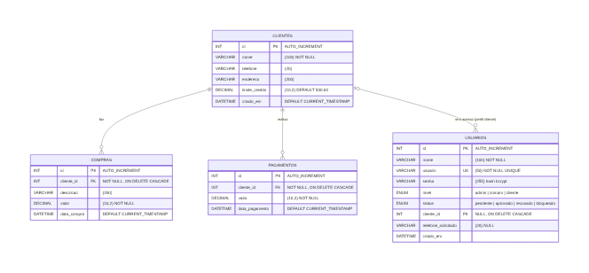

# FiadoFácil: Sistema de Fiado

Sistema web para pequenos comércios controlarem compras no fiado, pagamentos e dívidas de clientes, com relatórios, ranking de confiabilidade e uma área em que o próprio cliente consulta o que deve.

🔗 **Site no ar:** https://fiadofacil.free.je (contas de teste mais abaixo)

Projeto Integrador do curso de Gestão da TI (FPM, Goiânia/GO), feito por Matheus Wilton, Luiz Guilherme e Henrique Nascimento.

## Por que esse projeto existe

Muitos comércios de bairro ainda anotam o fiado num caderno. Fica difícil saber quem está devendo há muito tempo, quanto cada cliente ainda pode comprar e quem paga em dia. O FiadoFácil organiza isso: cada compra respeita o limite de crédito do cliente, cada pagamento abate a dívida mais antiga primeiro e o dono do comércio vê em um relatório quem está em dia, devendo ou inadimplente.

O problema é grande: em 2026 a Serasa registrou mais de 84 milhões de brasileiros inadimplentes (metade dos adultos), e pesquisas do Sebrae indicam que cerca de 4 em cada 10 microempreendedores vendem fiado, muitas vezes controlando tudo no papel. Os números e as fontes estão no [pitch](docs/PITCH.md).

## Documentação do Projeto Integrador

| Documento | Conteúdo |
|---|---|
| [Diagramas](docs/DIAGRAMAS.md) | Banco de dados (DER e diagrama de classes UML), casos de uso, fluxo do sistema, fluxo de compra e de pagamento, estados do cliente, sequência e arquitetura |
| [Case](docs/CASE.md) | Estudo de caso: problema, requisitos, solução aplicada e resultados |
| [Pitch](docs/PITCH.md) | Roteiro da apresentação, dados que justificam o projeto, comparação com outras soluções e fontes |
| [Demonstração ao vivo](docs/APRESENTACAO.md) | Roteiro para mostrar o sistema no computador e no celular |
| [Imagens](docs/img/) | Diagramas em PNG para os slides |



## Tecnologias

PHP · MySQL (SQL, transações) · HTML · CSS · JavaScript (layout responsivo: funciona no computador e no celular) · Git e GitHub · hospedagem na InfinityFree

## Destaques técnicos

- **Banco relacional com 4 tabelas** (`clientes`, `usuarios`, `compras`, `pagamentos`) e relatórios feitos com consultas SQL (filtros por período e situação, maiores devedores, resumo financeiro).
- **Transações com trava** (`SELECT ... FOR UPDATE`): duas compras feitas ao mesmo tempo não conseguem estourar o limite de crédito do cliente.
- **Segurança**:
  - consultas preparadas, contra SQL injection;
  - senhas guardadas com `password_hash`;
  - proteção CSRF nos formulários;
  - saída escapada com `htmlspecialchars`, contra XSS;
  - cookie de sessão `HttpOnly` e `SameSite`, e nova sessão a cada login;
  - a senha do banco fica fora do código.
- **Controle de acesso por perfil**: administrador, usuário comum e cliente (somente leitura).

## Funcionalidades

- Login com dois perfis de funcionário: **Administrador** e **Usuário comum**.
- Cadastro, edição, busca (por nome ou telefone) e exclusão de clientes. Só o administrador exclui.
- Extrato de cada cliente com dívida, limite disponível, compras e pagamentos.
- Registro de compras no fiado com validação do limite de crédito.
- Registro de pagamentos, com bloqueio de pagamento maior que a dívida e botão "Quitar dívida inteira".
- Relatório de dívidas com filtros por período e situação, pronto para imprimir.
- Ranking de confiabilidade dos clientes.
- Resumo financeiro e maiores devedores (somente administrador).
- Gestão de funcionários: criar, bloquear, desbloquear e redefinir senha (somente administrador).
- Troca da própria senha em "Minha senha".
- **Acesso do cliente (somente leitura):** o cliente pede um usuário na tela de login, o administrador aprova e o cliente passa a ver apenas a própria dívida.

## Regras de negócio

- **Situação do cliente**: *em dia* (sem dívida), *devendo* ou *inadimplente* (a compra mais antiga ainda não paga tem mais de 30 dias). Os pagamentos quitam as compras mais antigas primeiro.
- **Score do ranking**: começa em 100, perde 2 pontos por dia acima de 7 em aberto, perde 10 se a dívida passa de 50% do limite e ganha 5 se o cliente já pagou alguma vez.
- O usuário comum cadastra clientes com limite padrão de R$ 500. Só o administrador altera limites.
- Cliente com dívida em aberto não pode ser excluído. Excluir um cliente apaga o histórico e o acesso dele.

## Contas de teste

| Perfil | Usuário | Senha |
|---|---|---|
| Administrador | `admin` | `admin123` |
| Usuário comum | `usuario` | `user123` |

Clientes de exemplo: João Silva `(62) 99999-9999`, Maria Souza `(62) 98888-8888`, Carlos Pereira `(62) 97777-7777` e Ana Lima `(62) 96666-6666`.

> As contas de teste são públicas. Ao instalar o sistema para uso real, troque as senhas no primeiro acesso (menu **Minha senha**). O sistema avisa enquanto a senha de exemplo estiver em uso.

## Equipe

| Integrante | Responsabilidades |
|---|---|
| Matheus Wilton | _(preencher: ex. banco de dados, publicação do site)_ |
| Luiz Guilherme | _(preencher)_ |
| Henrique Nascimento | _(preencher)_ |

> Coloquem só o que cada um realmente fez: é a primeira pergunta da banca.

## Como rodar no computador (XAMPP)

1. Copie a pasta `fiadofacil` para `C:\xampp\htdocs\fiadofacil`. O `login.php` deve ficar direto dentro dela.
2. No XAMPP, ligue o **Apache** e o **MySQL**.
3. Em `http://localhost/phpmyadmin`, crie um banco chamado `sistema_fiado` (utf8mb4), selecione-o, vá em **Importar** e envie `fiadofacil/sql/banco.sql`.
4. Copie `config.local.example.php` para `config.local.php` (dentro de `fiadofacil`) e confira os dados. No XAMPP o padrão é host `localhost`, usuário `root`, senha vazia e banco `sistema_fiado`.
5. Acesse `http://localhost/fiadofacil/login.php`.

<details>
<summary><b>Publicar na InfinityFree</b></summary>

1. No painel, crie o banco MySQL e anote host, usuário, senha e nome do banco.
2. No phpMyAdmin da hospedagem, selecione o banco, vá em **Importar** e envie `sql/banco.sql`. Dá para importar de novo sem duplicar dados.
3. Envie o conteúdo da pasta `fiadofacil` para `htdocs`, sem deixar uma subpasta extra. **Não precisa enviar a pasta `sql`.**
4. Edite o `config.local.php` com os dados do banco **direto no servidor** (ou preencha antes de enviar).
5. Abra o endereço do site. O `index.php` encaminha para o login.

</details>

<details>
<summary><b>Problemas comuns</b></summary>

- **404 ao abrir o login:** a pasta não está em `htdocs` ou está duplicada (`fiadofacil\fiadofacil`).
- **"Falta o arquivo config.local.php":** copie o `config.local.example.php` para `config.local.php` e preencha.
- **"Não foi possível conectar ao banco":** confira host, usuário, senha e nome do banco no `config.local.php`.
- **O MySQL não liga no XAMPP:** outro MySQL do Windows pode estar usando a porta 3306. Pare o serviço dele em `services.msc`.

</details>

## Segurança da configuração

- A senha do banco **nunca** fica no código. Ela fica só no `config.local.php`, que está no `.gitignore`. **Cuidado: o botão "Upload files" do GitHub ignora o `.gitignore`, então não envie o `config.local.php` por ele.**
- Se alguma senha de banco já foi publicada no GitHub, troque-a no painel da hospedagem. Apagar do arquivo não adianta, porque o histórico do Git guarda a versão antiga.
- Senhas novas precisam ter no mínimo 8 caracteres.

## Estrutura

```
fiadofacil/
├── *.php                       páginas do sistema
├── cabecalho.php / rodape.php  layout e menu comuns a todas as páginas
├── funcoes.php                 funções compartilhadas (sessão, segurança, regras de compra e pagamento, situação dos clientes)
├── conexao.php                 conecta no banco usando o config.local.php
├── config.local.example.php    modelo do arquivo de configuração
├── css/estilo.css              visual
├── js/script.js                menu do celular, confirmações, máscara de telefone
└── sql/banco.sql               criação das tabelas e dados de exemplo
```

## Próximos passos

- Lembrete de cobrança pelo WhatsApp.
- Pagamento por Pix com QR Code.
- Versão instalável no celular (PWA).
- Testes automatizados das regras de negócio (limite de crédito, situação, score).
- Exportar o relatório em CSV.
- Capturas de tela neste README.
