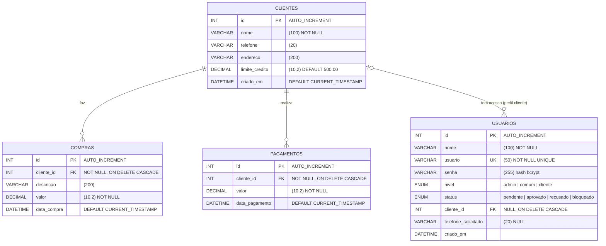
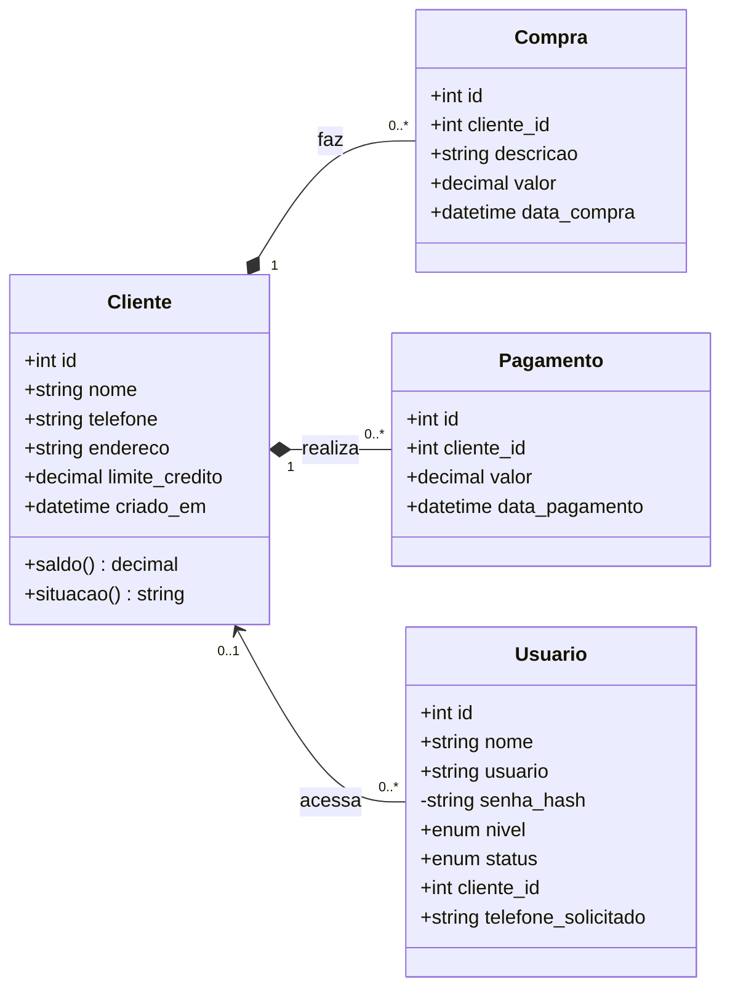
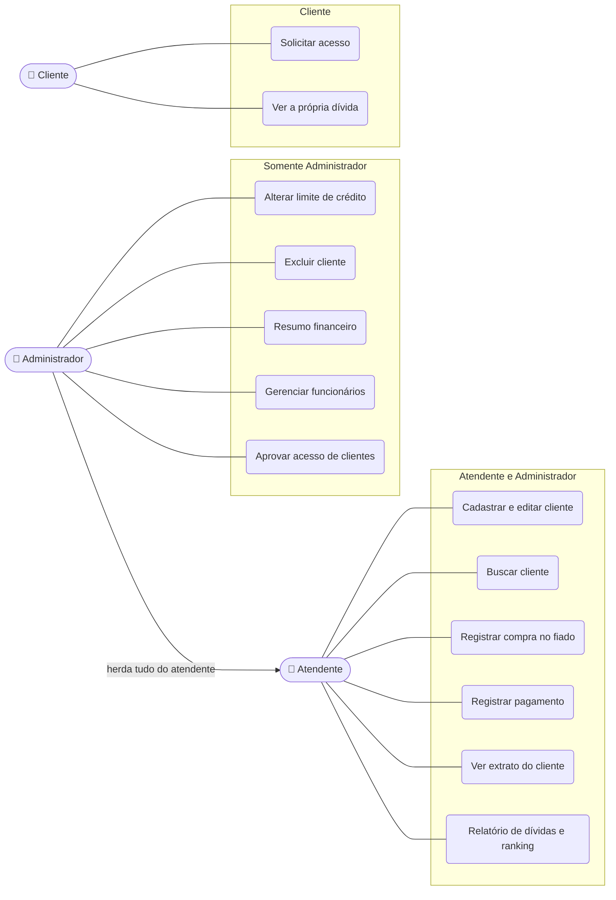
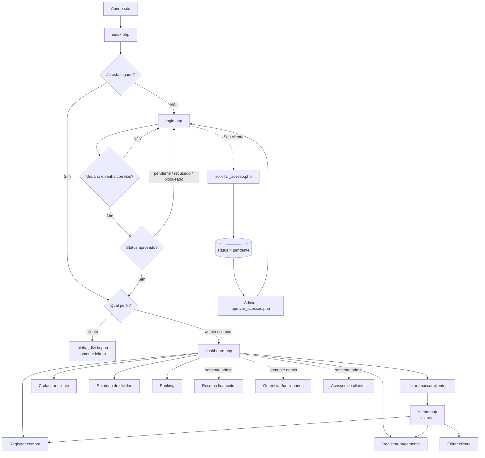
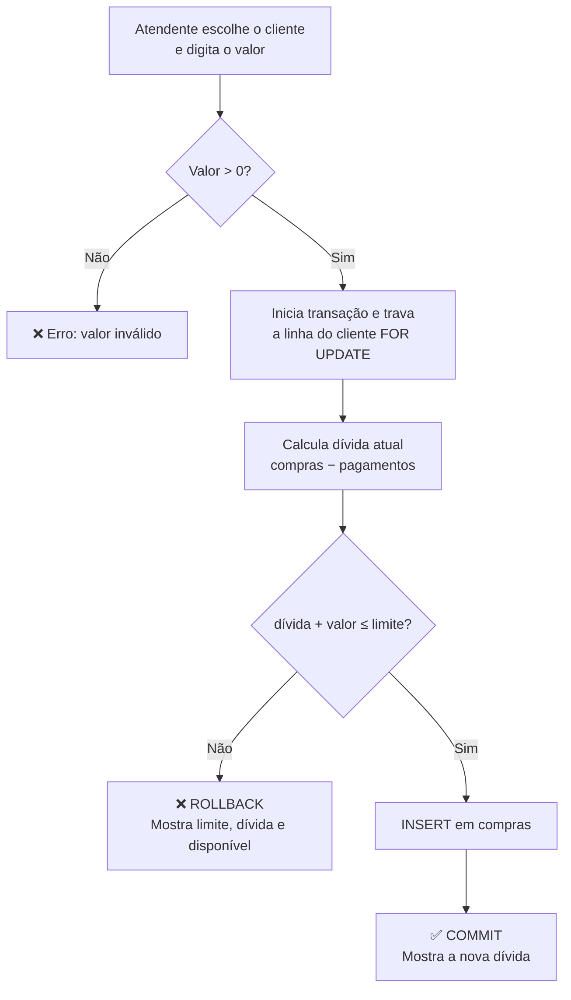
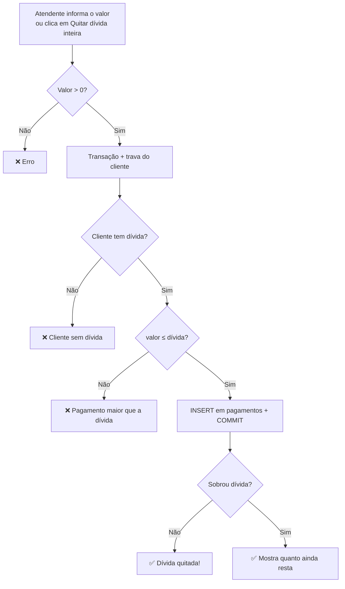
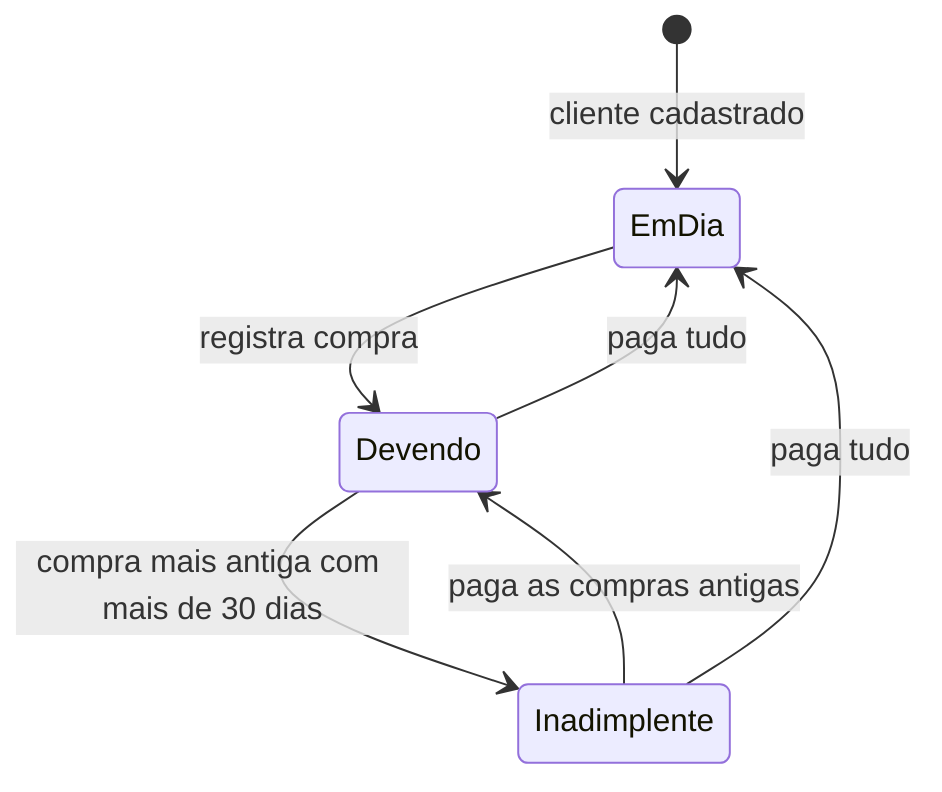
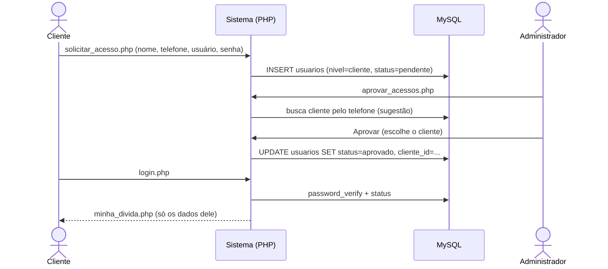
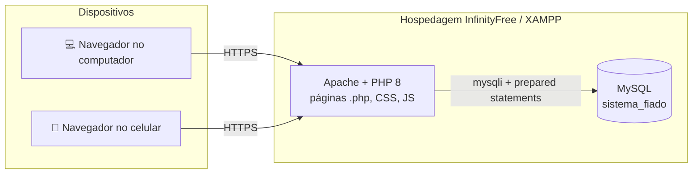

# Diagramas do FiadoFácil

Os diagramas estão em [Mermaid](https://mermaid.js.org/), que o GitHub desenha automaticamente ao abrir este arquivo.
Para exportar como imagem (PNG/SVG) para slides: cole o bloco em https://mermaid.live e clique em **Actions → PNG/SVG**.

---

## 1. Diagrama do banco de dados (UML / DER)

Modelo entidade-relacionamento das 4 tabelas do arquivo [`fiadofacil/sql/banco.sql`](../fiadofacil/sql/banco.sql).

**Cardinalidades**
- Um **cliente** tem 0..N **compras** e 0..N **pagamentos**. Cada compra/pagamento pertence a exatamente 1 cliente.
- Um **usuário** com `nivel = 'cliente'` aponta para 1 cliente (`cliente_id`). Funcionários (`admin`/`comum`) têm `cliente_id` nulo.
- Ao excluir um cliente, as compras, os pagamentos e o acesso dele são apagados (`ON DELETE CASCADE`).

**Por que não existe coluna "dívida"?** A dívida é sempre **calculada**: `SUM(compras.valor) − SUM(pagamentos.valor)`. Assim ela nunca fica desatualizada ou inconsistente.

### Diagrama de classes UML (mesmo modelo, notação UML)

---

## 2. Casos de uso (quem faz o quê)

> Todos os perfis fazem login e trocam a própria senha.

---

## 3. Fluxo geral do sistema (navegação)

---

## 4. Fluxo de uma compra no fiado (regra principal)

## 5. Fluxo de um pagamento

## 6. Situação do cliente (estados)

## 7. Sequência: cliente solicita acesso e vê a dívida

## 8. Arquitetura

