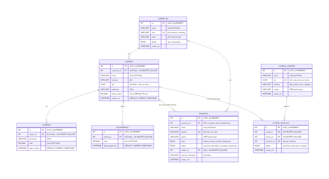

# Documentação técnica do FiadoFácil

Versão do banco de dados: **5** · Site: https://fiadofacil.free.je · Autor: Matheus Wilton

## Sumário
1. [Visão geral](#1-visão-geral)
2. [Requisitos](#2-requisitos)
3. [Perfis de acesso e permissões](#3-perfis-de-acesso-e-permissões)
4. [Regras de negócio](#4-regras-de-negócio)
5. [Arquitetura e tecnologias](#5-arquitetura-e-tecnologias)
6. [Estrutura de arquivos](#6-estrutura-de-arquivos)
7. [Banco de dados](#7-banco-de-dados)
8. [Várias lojas na mesma plataforma](#8-várias-lojas-na-mesma-plataforma)
9. [Conta única do cliente (CPF)](#9-conta-única-do-cliente-cpf)
10. [Segurança](#10-segurança)
11. [Integrações](#11-integrações)
12. [Interface e experiência de uso](#12-interface-e-experiência-de-uso)
13. [Instalação e configuração](#13-instalação-e-configuração)
14. [Publicação automática](#14-publicação-automática)
15. [Testes](#15-testes)
16. [Limitações e próximos passos](#16-limitações-e-próximos-passos)
17. [Glossário](#17-glossário)

---

## 1. Visão geral

O FiadoFácil substitui o caderninho do fiado. A loja cadastra os clientes com um **limite de crédito**, lança as **compras** e os **pagamentos**, e o sistema calcula sozinho a dívida, o limite disponível e a **situação** de cada cliente (em dia, devendo ou inadimplente).

A plataforma atende **várias lojas** ao mesmo tempo. Cada loja tem endereço, login, dados e visual próprios, e nenhuma enxerga os dados das outras. O **cliente** pode criar uma conta com CPF e senha e ver numa tela só o que deve em todas as lojas onde compra.

**Objetivos**
- Acabar com as contas feitas à mão e com o fiado esquecido no caderno.
- Reduzir a inadimplência com limite por cliente e lista de atrasados.
- Dar transparência ao cliente, que confere o próprio extrato.
- Funcionar no computador e no celular, com custo zero de hospedagem.

---

## 2. Requisitos

### Funcionais
| Código | Requisito |
|---|---|
| RF01 | Cadastrar, editar, buscar (nome ou telefone) e excluir clientes, com limite de crédito, CPF opcional e endereço com busca por CEP. |
| RF02 | Registrar compras no fiado, impedindo que a dívida passe do limite. |
| RF03 | Registrar pagamentos parciais ou totais, impedindo pagar mais do que a dívida. |
| RF04 | Mostrar o extrato do cliente: compras, pagamentos, dívida e limite disponível. |
| RF05 | Classificar o cliente como em dia, devendo ou inadimplente. |
| RF06 | Gerar relatório de dívidas por período e situação, pronto para imprimir. |
| RF07 | Mostrar o ranking de confiabilidade dos clientes. |
| RF08 | Mostrar o resumo financeiro e os maiores devedores (administrador). |
| RF09 | Gerenciar funcionários: criar, bloquear, desbloquear e trocar senha (administrador). |
| RF10 | Permitir que o cliente peça acesso e veja somente a própria dívida, depois da aprovação da loja. |
| RF11 | Atender várias lojas com dados isolados, cada uma com endereço e visual próprios. |
| RF12 | Painel do dono da plataforma: listar, criar, bloquear e entrar nas lojas. |
| RF13 | Conta única do cliente por CPF e senha, com as dívidas de todas as lojas que confirmaram a ligação. |
| RF14 | Gerar Pix com QR Code e "copia e cola" no valor da dívida. |
| RF15 | Abrir a cobrança pelo WhatsApp com a mensagem pronta. |
| RF16 | Oferecer uma API REST somente leitura por loja. |
| RF17 | Cada usuário troca a própria senha. |

### Não funcionais
| Código | Requisito |
|---|---|
| RNF01 | Funcionar no navegador do computador e do celular (layout responsivo e instalável na tela inicial). |
| RNF02 | Custo zero de hospedagem. |
| RNF03 | Senhas guardadas com hash; proteção contra SQL Injection, XSS, CSRF e IDOR; HTTPS obrigatório. |
| RNF04 | Interface simples, em português, com modo claro e noturno e boa leitura (contraste e tamanho de letra). |
| RNF05 | Respeitar a LGPD: dados mínimos, CPF mascarado na tela e política de privacidade. |
| RNF06 | Publicação automática a cada atualização do código. |

---

## 3. Perfis de acesso e permissões

| Ação | Atendente (`comum`) | Administrador (`admin`) | Cliente | Dono da plataforma |
|---|:-:|:-:|:-:|:-:|
| Ver início, clientes, extratos, relatório e ranking | ✅ | ✅ | ❌ | ✅ (dentro da loja) |
| Cadastrar e editar cliente | ✅ (limite padrão R$ 500) | ✅ | ❌ | ✅ |
| Alterar limite de crédito | ❌ | ✅ | ❌ | ✅ |
| Excluir cliente (sem dívida) | ❌ | ✅ | ❌ | ✅ |
| Registrar compra e pagamento | ✅ | ✅ | ❌ | ✅ |
| Resumo financeiro | ❌ | ✅ | ❌ | ✅ |
| Gerenciar funcionários | ❌ | ✅ | ❌ | ✅ |
| Aprovar acessos e contas de clientes | ❌ | ✅ | ❌ | ✅ |
| Minha loja (Pix, WhatsApp e API) | ❌ | ✅ | ❌ | ✅ |
| Ver a própria dívida | — | — | ✅ (só a dele) | — |
| Criar, bloquear e entrar nas lojas | ❌ | ❌ | ❌ | ✅ |

As permissões são conferidas **no servidor** em cada página (`verifica_login.php` e `verifica_admin.php`), e não só escondendo botões. A cada página o sistema também confere no banco se o usuário e a loja continuam ativos: um bloqueio vale no clique seguinte.

---

## 4. Regras de negócio

**Dívida**
- A dívida **não é guardada numa coluna**: é sempre calculada como `soma das compras − soma dos pagamentos`. Assim nunca fica diferente do histórico.

**Compra no fiado**
- O valor precisa ser maior que zero.
- A compra só é aceita se `dívida atual + valor ≤ limite de crédito`. Se passar, o sistema recusa e mostra o limite, a dívida e quanto ainda está disponível.
- A verificação roda dentro de uma **transação** com a linha do cliente travada (`SELECT ... FOR UPDATE`). Duas compras ao mesmo tempo não conseguem estourar o limite.

**Pagamento**
- O valor precisa ser maior que zero e menor ou igual à dívida. Não se aceita pagamento de quem não deve.
- O botão "Quitar dívida inteira" preenche o valor exato da dívida.
- O pagamento abate as **compras mais antigas primeiro** (ordem FIFO).

**Situação do cliente**
| Situação | Quando |
|---|---|
| Em dia | Não deve nada. |
| Devendo | Deve, e a compra mais antiga ainda não paga tem até 30 dias. |
| Inadimplente | A compra mais antiga ainda não paga tem mais de 30 dias. |

Os "dias em aberto" são contados a partir da compra mais antiga que os pagamentos ainda não cobriram.

**Score do ranking (0 a 100)**
- Começa em 100.
- Perde 2 pontos por dia em aberto acima de 7 dias.
- Perde 10 pontos se a dívida passar de 50% do limite.
- Ganha 5 pontos se o cliente já fez algum pagamento.
- Classificação: **80 ou mais** confiável, **50 a 79** regular, **abaixo de 50** risco.

**Cadastro e exclusão**
- Só o nome é obrigatório. Telefone e CPF, quando informados, são validados e não podem repetir dentro da mesma loja.
- O atendente cadastra com o limite padrão de **R$ 500**; só o administrador muda o limite.
- Cliente com dívida em aberto **não pode ser excluído**. Ao excluir, o histórico e os acessos dele são apagados juntos.

**Senhas**
- No mínimo 8 caracteres para senhas novas.
- O início mostra um aviso enquanto a conta usa uma senha de exemplo.

---

## 5. Arquitetura e tecnologias

```
Navegador (computador ou celular)
        │  HTTPS
        ▼
Apache + PHP 8 (páginas .php, CSS e JavaScript)
        │  mysqli + prepared statements
        ▼
MySQL / MariaDB (banco sistema_fiado)
```

| Camada | Tecnologia | Por quê |
|---|---|---|
| Servidor | PHP 8 com mysqli | Roda em qualquer hospedagem, inclusive gratuita. |
| Banco | MySQL / MariaDB (InnoDB, utf8mb4) | Relacional, com transações e chaves estrangeiras. |
| Interface | HTML, CSS e JavaScript puros | Leve, sem dependências, e mostra domínio da base. |
| Versionamento | Git e GitHub | Histórico do código e documentação. |
| Publicação | GitHub Actions + FTP | Envia o site sozinho a cada atualização. |
| Hospedagem | InfinityFree | Gratuita, com PHP e MySQL. |

Diagramas completos (casos de uso, fluxos, sequência e arquitetura) estão em [DIAGRAMAS.md](DIAGRAMAS.md).

**Como uma página funciona:** a página inclui `verifica_login.php` (confere a sessão, a loja e o perfil), depois `conexao.php` (abre o banco e roda as migrações pendentes), faz as consultas com prepared statements filtradas pela loja e monta o HTML entre `cabecalho.php` e `rodape.php`.

---

## 6. Estrutura de arquivos

```
fiadofacil/
├── index.php                  página de apresentação (antes do login)
├── login.php                  "Qual é a sua loja?" e login dos funcionários
├── painel.php                 painel do dono da plataforma
├── dashboard.php              início da loja (totais, quem precisa de atenção, últimas movimentações)
├── listar_clientes.php        lista com busca e paginação (10 por página)
├── cadastro_cliente.php       novo cliente (CPF e CEP opcionais)
├── editar_cliente.php         editar cliente
├── excluir_cliente.php        excluir (só administrador, só por POST, só sem dívida)
├── cliente.php                extrato do cliente + cobrança pelo WhatsApp
├── registrar_compra.php       compra no fiado (com limite)
├── registrar_pagamento.php    pagamento (parcial ou total)
├── relatorio.php              relatório por período e situação (com impressão)
├── ranking.php                ranking de confiabilidade
├── resumo.php                 resumo financeiro (administrador)
├── usuarios.php               funcionários (administrador)
├── aprovar_acessos.php        pedidos de acesso e contas por CPF (administrador)
├── acessos_clientes.php       acessos de clientes por usuário (administrador)
├── minha_loja.php             Pix, WhatsApp e chave da API (administrador)
├── minha_senha.php            trocar a própria senha
├── minha_divida.php           tela do cliente com acesso por usuário (uma loja)
├── solicitar_acesso.php       cliente pede acesso por usuário a uma loja
├── conta_entrar.php           área do cliente: entrar com CPF e senha
├── conta_criar.php            área do cliente: criar a conta
├── minhas_dividas.php         área do cliente: dívidas em todas as lojas
├── api.php                    API REST somente leitura (JSON)
├── privacidade.php            política de privacidade (LGPD)
├── 404.php                    página de endereço inexistente (e atalho para /loja/nome)
├── logout.php                 sair
├── funcoes.php                funções comuns: sessão, loja, segurança, regras, Pix, CPF
├── verifica_login.php         exige login e confere usuário e loja a cada página
├── verifica_admin.php         exige perfil administrador
├── conexao.php                conexão com o banco (usa config.local.php)
├── migracoes.php              atualização automática da estrutura do banco
├── desenhos.php               desenhos em SVG de cada ramo (bife, pão, sacola, cenários do login, balança)
├── cabecalho.php / rodape.php layout das páginas internas e menu
├── layout_publico.php         layout das páginas públicas
├── config.local.example.php   modelo do arquivo de configuração
├── .htaccess                  HTTPS, endereço /loja/nome, página 404, bloqueio de arquivos
├── manifest.json              instalação na tela inicial do celular
├── css/estilo.css, inicio.css estilos (claro, noturno, temas das lojas, celular)
├── css/lojas.css              animações de cada ramo (açougue, mercearia, padaria)
├── js/script.js               menu, tabelas em cartões, máscaras, CEP, QR Code, animações
├── js/qrcode.js               gerador de QR Code (licença MIT, Kazuhiko Arase)
├── img/                       emblema, ícones e foto
└── sql/banco.sql              estrutura inicial e dados de exemplo
```

---

## 7. Banco de dados

São **7 tabelas** (InnoDB, utf8mb4). O diagrama está em [DIAGRAMAS.md](DIAGRAMAS.md#1-diagrama-do-banco-de-dados-uml--der).



### Dicionário de dados

**`comercios`**: as lojas.
| Coluna | Tipo | Regra |
|---|---|---|
| id | INT | chave primária |
| nome | VARCHAR(100) | obrigatório |
| slug | VARCHAR(60) | único; endereço `/loja/slug` |
| tema | VARCHAR(30) | visual da loja (padrao, mercearia, padaria, acougue) |
| status | ENUM | `ativo` ou `bloqueado` |
| chave_pix | VARCHAR(77) | chave Pix da loja (opcional) |
| pix_cidade | VARCHAR(15) | cidade que vai no Pix |
| api_token_hash | CHAR(64) | hash SHA-256 da chave da API; único |
| criado_em | DATETIME | data de criação |

**`clientes`**: os clientes de cada loja.
| Coluna | Tipo | Regra |
|---|---|---|
| id | INT | chave primária |
| comercio_id | INT | loja; obrigatório; apaga junto com a loja |
| nome | VARCHAR(100) | obrigatório |
| telefone | VARCHAR(20) | formato (62) 99999-9999 |
| cpf | CHAR(11) | só números; único por loja (`UNIQUE(comercio_id, cpf)`) |
| endereco | VARCHAR(200) | opcional |
| limite_credito | DECIMAL(10,2) | padrão 500,00 |
| criado_em | DATETIME | data do cadastro |

**`compras`**
| Coluna | Tipo | Regra |
|---|---|---|
| id | INT | chave primária |
| cliente_id | INT | apaga junto com o cliente |
| descricao | VARCHAR(200) | opcional |
| valor | DECIMAL(10,2) | maior que zero |
| data_compra | DATETIME | data e hora da compra |

**`pagamentos`**
| Coluna | Tipo | Regra |
|---|---|---|
| id | INT | chave primária |
| cliente_id | INT | apaga junto com o cliente |
| valor | DECIMAL(10,2) | maior que zero e até a dívida |
| data_pagamento | DATETIME | data e hora do pagamento |

**`usuarios`**: funcionários, acessos de cliente por usuário e o dono da plataforma.
| Coluna | Tipo | Regra |
|---|---|---|
| id | INT | chave primária |
| comercio_id | INT | loja; nulo só para o dono da plataforma |
| nome | VARCHAR(100) | obrigatório |
| usuario | VARCHAR(50) | único por loja (`UNIQUE(comercio_id, usuario)`) |
| senha | VARCHAR(255) | hash bcrypt |
| nivel | ENUM | `admin`, `comum`, `cliente` ou `plataforma` |
| status | ENUM | `pendente`, `aprovado`, `recusado` ou `bloqueado` |
| cliente_id | INT | para o nível `cliente`: o cadastro dele |
| telefone_solicitado | VARCHAR(20) | telefone informado no pedido de acesso |
| criado_em | DATETIME | data de criação |

**`contas_clientes`**: a conta única do cliente.
| Coluna | Tipo | Regra |
|---|---|---|
| id | INT | chave primária |
| nome | VARCHAR(100) | obrigatório |
| cpf | CHAR(11) | único |
| telefone | VARCHAR(20) | precisa conferir com o cadastro de uma loja |
| senha | VARCHAR(255) | hash bcrypt |
| criado_em | DATETIME | data de criação |

**`contas_vinculos`**: liga a conta ao cadastro do cliente em cada loja.
| Coluna | Tipo | Regra |
|---|---|---|
| id | INT | chave primária |
| conta_id | INT | apaga junto com a conta |
| cliente_id | INT | apaga junto com o cliente |
| comercio_id | INT | loja que confirma |
| status | ENUM | `pendente`, `aprovado` ou `recusado` |
| criado_em | DATETIME | data do pedido |

Índice único `(conta_id, cliente_id)`: uma conta não se liga duas vezes ao mesmo cadastro.

### Decisões de projeto
- **Dívida calculada**, não guardada: uma informação, uma fonte.
- **`DECIMAL(10,2)` para dinheiro**, e não FLOAT, que soma erros de arredondamento.
- **`ON DELETE CASCADE`**: excluir um cliente apaga compras, pagamentos e acessos, sem deixar registros órfãos.
- **`ENUM`** para perfis e situações: o banco recusa valores fora da lista.
- **Paginação** com `LIMIT` e `OFFSET` (10 por página).

### Migrações automáticas
O arquivo `migracoes.php` roda na primeira visita de cada sessão e atualiza a estrutura sem perder dados. Cada passo confere antes de mudar, então pode rodar várias vezes (é **idempotente**).

| Etapa | O que faz |
|---|---|
| Várias lojas | Cria `comercios`, adiciona `comercio_id` em clientes e usuários, cria o perfil `plataforma` e troca o índice de usuário para "único por loja". Os dados antigos viram a "Loja principal". |
| Senhas de exemplo | Troca as senhas das contas de exemplo por senhas simples, sem mexer em senha que o dono já trocou. |
| Integrações | Adiciona a chave Pix e a chave da API às lojas. |
| Conta do cliente | Adiciona o CPF aos clientes e cria `contas_clientes` e `contas_vinculos`. |

Para instalar do zero basta importar `sql/banco.sql` (as 4 tabelas originais e dados de exemplo): na primeira visita, as migrações criam o resto.

---

## 8. Várias lojas na mesma plataforma

O modelo é **multi-tenant com banco compartilhado**: todas as lojas usam o mesmo banco, e cada registro sabe a qual loja pertence.

- **Endereço da loja:** `/loja/nome-da-loja`. O `.htaccess` transforma em `login.php?loja=nome-da-loja`, sem diferenciar maiúsculas. Se a hospedagem não aplicar a regra, a página 404 faz o mesmo papel.
- **Entrada sem endereço:** a tela pergunta "Qual é a sua loja?" e procura pelo nome (aceita sem acento e só um pedaço).
- **A loja vem da sessão:** a função `loja_id()` lê a loja só da sessão, nunca de formulário ou URL. Toda consulta tem `WHERE comercio_id = ?`.
- **Proteção contra IDOR:** antes de mostrar ou alterar um registro por id, o sistema confere se ele é da loja (`cliente_da_loja()`). Se não for, responde como se não existisse.
- **Mesmo usuário em lojas diferentes:** "joao" da Mercearia e "joao" da Padaria são pessoas diferentes.
- **Visual por loja:** cada loja tem um tema de cores e o próprio nome no letreiro 3D do login.
- **Bloqueio de loja:** a cada página o sistema confere se a loja está ativa; bloqueada, todos daquela loja saem no clique seguinte.
- **Painel da plataforma (`painel.php`):** login próprio, só para o nível `plataforma`. Lista as lojas com números, cria loja nova (com o administrador dela), bloqueia, desbloqueia e entra em qualquer loja como administrador. Dentro da loja aparece uma faixa avisando.

---

## 9. Conta única do cliente (CPF)

Fluxo:
1. A loja inclui o CPF no cadastro do cliente.
2. O cliente cria a conta em `conta_criar.php` com nome, CPF, telefone e senha.
3. O sistema cria um pedido de ligação **pendente** para cada loja ativa que tem aquele CPF.
4. Cada loja confirma em **Aprovar acessos** (aparece se o telefone confere com o cadastro).
5. O cliente entra com CPF e senha e vê em `minhas_dividas.php` o total geral e um cartão por loja, com a dívida, o limite, o Pix e as últimas movimentações.

Proteções:
- A conta só é criada se alguma loja tiver aquele CPF **com o mesmo telefone**.
- Nenhuma loja aparece antes de **confirmar** a ligação.
- Se a loja trocar ou apagar o CPF do cadastro, a ligação é apagada.
- A tela só mostra cadastros cujo CPF continua igual ao da conta, de lojas ativas.
- O CPF é validado pelos dígitos verificadores e aparece mascarado (`***.982.247-**`).
- **As lojas continuam isoladas:** uma loja nunca vê quanto o cliente deve em outra.
- A sessão do cliente é separada da sessão de funcionário: uma conta de cliente não abre as telas da loja.

O acesso antigo do cliente (usuário e senha numa loja, `solicitar_acesso.php` e `minha_divida.php`) continua funcionando.

---

## 10. Segurança

| Ameaça | Proteção no FiadoFácil |
|---|---|
| SQL Injection | Prepared statements (`prepare` + `bind_param`) em todas as consultas. |
| XSS | `htmlspecialchars` em tudo que vem do usuário antes de mostrar. |
| CSRF | Token aleatório (`random_bytes`) em todo formulário, conferido com `hash_equals`. |
| Vazamento de senhas | `password_hash` (bcrypt) e `password_verify`; nunca se guarda a senha. |
| Roubo de sessão | Cookie `HttpOnly`, `SameSite=Lax`, `Secure` no HTTPS e `session_regenerate_id` no login. |
| Força bruta | Atraso de 0,6 s a cada erro e bloqueio de 5 minutos depois de 5 erros. |
| Robôs (spam) | Campo invisível que só robôs preenchem e tempo mínimo de 3 segundos para enviar. |
| IDOR | Todo acesso por id confere se o registro é da loja da sessão. |
| Mensagens que ajudam o invasor | Login com erro genérico ("Usuário ou senha inválidos"). |
| Senha no código | Dados do banco só em `config.local.php`, fora do Git. |
| Conexão sem criptografia | HTTPS obrigatório pelo `.htaccess`. |
| Download de arquivos internos | O `.htaccess` bloqueia `.sql`, `.md`, `.txt` e arquivos de configuração e migração. |
| Chave da API vazada do banco | Só o hash SHA-256 da chave fica no banco; a chave aparece uma vez. |

---

## 11. Integrações

| Integração | Como funciona |
|---|---|
| **Pix com QR Code** | O PHP monta o **BR Code** do Banco Central (campos EMV: id, tamanho e valor) com a chave, o valor, o nome e a cidade da loja, e termina com um **CRC16** de conferência. O texto é o "copia e cola" e vira o QR Code no navegador. É um Pix estático: o dinheiro cai direto na conta da loja, que confere e registra o pagamento. |
| **WhatsApp** | Link `https://wa.me/55DDDNUMERO?text=...` com a mensagem pronta (nome, valor e chave Pix). Não precisa de chave: quem abre é o aparelho de quem clicou. |
| **ViaCEP** | O JavaScript consulta `viacep.com.br/ws/CEP/json/` e preenche o endereço. Se a consulta falhar, o campo continua editável. |
| **API REST** | `api.php`, somente leitura, autenticada pela chave da loja no cabeçalho `X-Api-Key`. Detalhes em [API.md](API.md). |

**Limite da hospedagem gratuita:** a InfinityFree bloqueia chamadas do PHP para fora e tem uma proteção contra robôs. Por isso o Pix não tem confirmação automática por webhook, não há envio de e-mail e a API funciona completa no XAMPP ou em hospedagem paga.

---

## 12. Interface e experiência de uso

- **Responsiva:** no celular, o menu vira um botão e as tabelas viram cartões (o JavaScript copia o nome da coluna para cada célula).
- **Modo claro e noturno** com variáveis CSS, salvo no aparelho; na primeira visita segue o tema do sistema.
- **Tema por loja** (verde, caramelo, vinho) e letreiro 3D com o nome da loja no login.
- **Menu lateral** recolhível, com ícones SVG que usam a cor do texto.
- **Acessibilidade:** contraste conferido, cor sempre acompanhada de texto e animações desligadas para quem ativa "reduzir movimento".
- **Instalável** na tela inicial do celular (`manifest.json`).
- **Prévia ao compartilhar** o link (metatags Open Graph).
- **Animações de cada ramo** (`css/lojas.css` e `desenhos.php`), todas em SVG e CSS, sem imagens:

| Loja | Animações |
|---|---|
| Açougue | Carnes penduradas balançando no login, lousa de preços no "Precisam de atenção", números como painel de senha, balança de ponteiro no uso do limite, bife "chiando" no menu, cutelo que corta o botão de compra, bancada de mármore. |
| Mercearia | Toldo listrado ondulando, prateleiras com frutas pulando no login, cartões como etiquetas de preço penduradas, ripas de caixote nos painéis, extrato abrindo como página de caderno, sacola com frutas. |
| Padaria | Vapor saindo dos pães no login, letreiro com brilho de forno, cartões crescendo como massa, barra do limite como termômetro que esquenta, farinha polvilhada no fundo, sino de balcão nos pedidos. |
| Todas | Tela vazia ilustrada, mensagem de sucesso com o desenho da loja e, ao quitar uma dívida, chuva de bifes, pães ou frutas. |

---

## 13. Instalação e configuração

### No computador (XAMPP)
1. Copie a pasta `fiadofacil` para `C:\xampp\htdocs\fiadofacil`.
2. No XAMPP, ligue o **Apache** e o **MySQL**.
3. Em `http://localhost/phpmyadmin`, crie o banco `sistema_fiado` (utf8mb4) e importe `fiadofacil/sql/banco.sql`.
4. Copie `config.local.example.php` para `config.local.php` e confira os dados (no XAMPP: host `localhost`, usuário `root`, senha vazia, banco `sistema_fiado`).
5. Abra `http://localhost/fiadofacil/`. Na primeira visita, as migrações criam as tabelas novas e as lojas de exemplo.

### Configuração (`config.local.php`)
| Variável | Conteúdo |
|---|---|
| `$banco_host` | servidor do banco |
| `$banco_usuario` | usuário do banco |
| `$banco_senha` | senha do banco |
| `$banco_nome` | nome do banco |

Esse arquivo **nunca** vai para o GitHub (está no `.gitignore`) nem é enviado pela publicação automática.

### Problemas comuns
| Mensagem | Solução |
|---|---|
| "Falta o arquivo config.local.php" | Copie o modelo e preencha. |
| "Não foi possível conectar ao banco de dados. Motivo: ..." | O motivo diz o que conferir (usuário, senha, nome do banco ou servidor). |
| Página 404 ao abrir | A pasta não está em `htdocs` ou ficou duplicada (`fiadofacil/fiadofacil`). |
| MySQL não liga no XAMPP | Outro MySQL do Windows está usando a porta 3306. |

---

## 14. Publicação automática

### Fluxo de trabalho (padrão de empresa)
```
branch "teste"  ──►  testes automáticos  ──►  Pull Request para a main  ──►  testes de novo  ──►  site no ar
```
1. Toda mudança vai primeiro para a branch **`teste`**; os testes rodam sozinhos.
2. Com os testes verdes, abre-se um **Pull Request** da `teste` para a `main`; o GitHub roda os testes de novo e mostra o resultado no pedido.
3. Ao clicar em **Merge**, a `main` é atualizada e a publicação começa, mas **só publica se os testes passarem**.

### Publicação
O workflow `.github/workflows/deploy.yml` roda a cada atualização da `main` que mexe na pasta `fiadofacil`:
1. Roda os testes automáticos (`.github/workflows/testes.yml`); se algum falhar, para aqui.
1. Baixa o código.
2. Envia por FTP para a pasta `htdocs` da InfinityFree, sem o `config.local.php` e sem a pasta `sql`.
3. Testa se o site responde.

Os dados do FTP ficam nos **Secrets** do GitHub (`FTP_SERVER`, `FTP_USERNAME`, `FTP_PASSWORD`). Também é possível publicar na hora em **Actions → Publicar na InfinityFree → Run workflow**.

---

## 15. Testes

Os testes ficam na pasta [`testes/`](../testes/README.md) e rodam **sozinhos no GitHub Actions** a cada envio para a branch `teste`, em todo Pull Request e antes de cada publicação. Cada execução cria um banco MariaDB novo, importa o `banco.sql`, roda as migrações, liga o site com o PHP e usa um navegador automatizado (Playwright). As contas de teste recebem uma senha própria, então nenhuma senha real fica no código.

| Conjunto | O que confere | Resultado |
|---|---|---|
| Isolamento entre lojas (34 casos) | Uma loja não vê, edita, exclui nem lança compra ou pagamento em cliente de outra, pela URL ou pelo formulário; mesmo usuário em lojas diferentes; bloqueio de loja derruba a sessão; painel cria, bloqueia e entra nas lojas; uma loja não confirma conta de cliente de outra. | Todos passaram |
| Conta do cliente por CPF (23 casos) | Entrar, senha errada, CPF inválido e repetido, conta só com telefone que confere, pendente até a loja confirmar, outra loja não vê o pedido, CPF trocado desliga a conta, celular sem rolagem lateral, sair. | Todos passaram |
| Integrações | Pix com CRC conferido, QR Code gerado, link do WhatsApp, CEP preenchendo o endereço, API com códigos 200, 401, 404 e 405 e sem acesso a clientes de outra loja. | Todos passaram |
| Funções (`unidade.php`) | CPF, telefone, dinheiro, Pix (BR Code e CRC16), chave Pix e link do WhatsApp. | Todos passaram |
| Regras de negócio (`regras.js`) | Limite de crédito, valor zero, pagamento maior que a dívida, cliente sem dívida, exclusão bloqueada com dívida, filtro de inadimplentes, permissões do atendente, escolha da loja, endereço com maiúsculas e página 404. | Todos passaram |

---

## 16. Limitações e próximos passos

**Limitações conhecidas**
- Os testes de unidade são um script próprio; o próximo passo seria usar o PHPUnit.
- PHP e HTML misturados nas páginas; o ideal seria organizar em camadas (MVC).
- A situação e os dias em aberto usam subconsultas por cliente; com milhares de clientes ficaria lento.
- O limite de tentativas de login vale por sessão; um robô pode abrir sessões novas.
- Não registra qual funcionário lançou cada compra (auditoria).
- Na hospedagem gratuita: sem Pix com confirmação automática, sem e-mail e sem API para programas de fora.

**Próximos passos**
- Um site de teste separado, publicado a partir da branch `teste`.
- Pix com confirmação automática por webhook de um provedor de pagamento.
- Recuperação de senha e avisos por e-mail.
- Exportar relatório em CSV e gráficos de evolução.
- Registro de auditoria (quem lançou cada compra).

---

## 17. Glossário

| Termo | Significado |
|---|---|
| Fiado | Venda a prazo anotada para o cliente pagar depois. |
| Inadimplente | Cliente com compra não paga há mais de 30 dias. |
| Multi-tenant | Um sistema que atende vários clientes (lojas) com dados separados. |
| Slug | Nome da loja em formato de endereço (`mercearia-do-ze`). |
| IDOR | Acesso indevido a um registro trocando o número (id) no endereço. |
| CSRF | Ataque em que outro site faz o navegador enviar um formulário sem a pessoa saber. |
| XSS | Código malicioso gravado num campo e executado no navegador de outra pessoa. |
| Hash | Resumo de mão única de um texto; usado para guardar senhas sem guardar a senha. |
| BR Code | Padrão do Banco Central para o Pix "copia e cola" e o QR Code. |
| API REST | Interface que entrega dados por endereços HTTP, normalmente em JSON. |
| Migração | Script que atualiza a estrutura do banco sem perder os dados. |
