# Manual do usuário do FiadoFácil

Passo a passo de cada tela, por perfil. Endereço: https://fiadofacil.free.je

## Sumário
- [Entrar no sistema](#entrar-no-sistema)
- [Atendente e administrador](#atendente-e-administrador)
- [Somente o administrador](#somente-o-administrador)
- [Cliente](#cliente)
- [Dono da plataforma](#dono-da-plataforma)
- [No celular](#no-celular)
- [Perguntas frequentes](#perguntas-frequentes)

---

## Entrar no sistema

### 1. Escolher a loja
Clique em **Entrar**. O sistema pergunta **"Qual é a sua loja?"**. Digite o nome (pode ser sem acento ou só um pedaço, como "padaria") e clique em **Continuar**. Se mais de uma loja combinar, escolha a sua na lista.

Atalho: cada loja tem um endereço próprio, como `fiadofacil.free.je/loja/mercearia-do-ze`.

### 2. Usuário e senha
Na tela da loja (com o nome dela no letreiro), digite o **usuário** e a **senha** que o administrador passou. Para entrar em outra loja, use **"Trocar de loja"**.

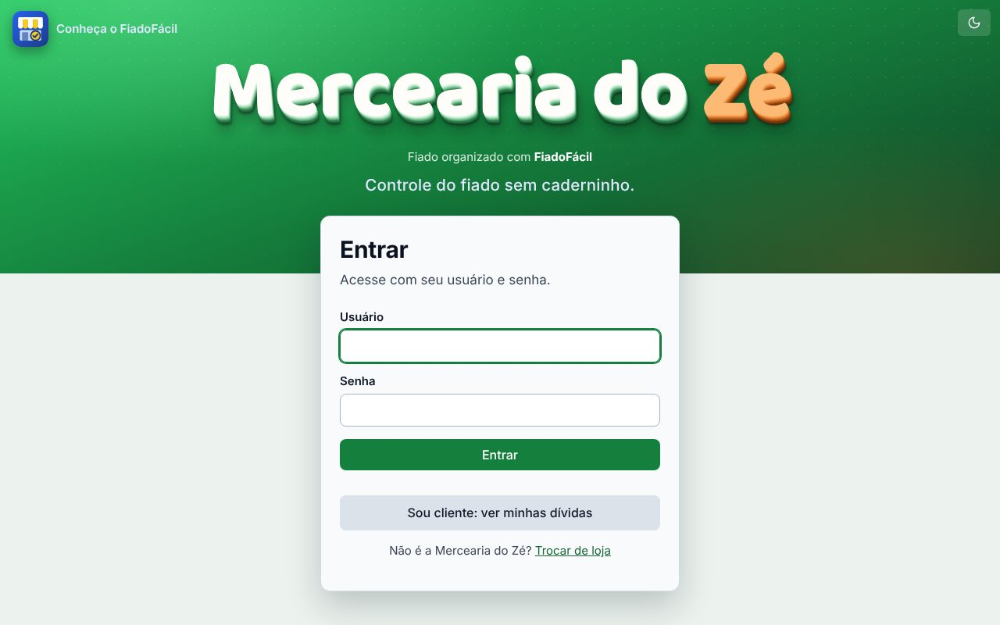

> Depois de 5 senhas erradas seguidas, o login espera 5 minutos.

---

## Atendente e administrador

### Início
Mostra os totais da loja (clientes, quantos estão devendo, inadimplentes e total a receber), os atalhos para registrar compra e pagamento, a lista **"Precisam de atenção"** (com o botão do WhatsApp) e as **últimas movimentações**.

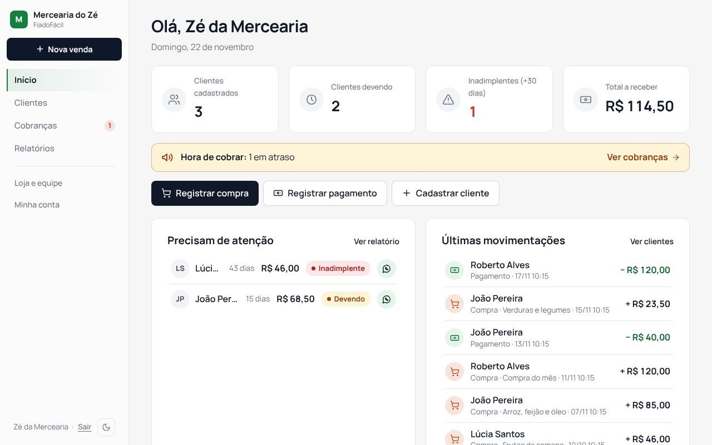

### Clientes
Lista os clientes com limite e saldo devedor, 10 por página. Busque pelo **nome ou telefone**. Em cada cliente: **Extrato**, **Editar** e, para o administrador, **Excluir**.

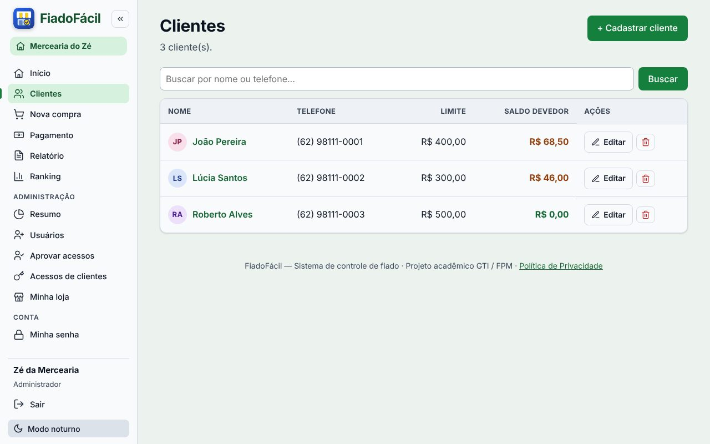

### Cadastrar cliente
Só o nome é obrigatório.
- **Telefone:** com DDD; o formato se ajusta sozinho.
- **CPF (opcional):** serve para o cliente ver o fiado pela conta dele.
- **CEP:** digite os 8 números e o endereço se preenche sozinho; complete o número.
- **Limite de crédito:** quanto o cliente pode dever ao mesmo tempo. O atendente cadastra com R$ 500; só o administrador muda.

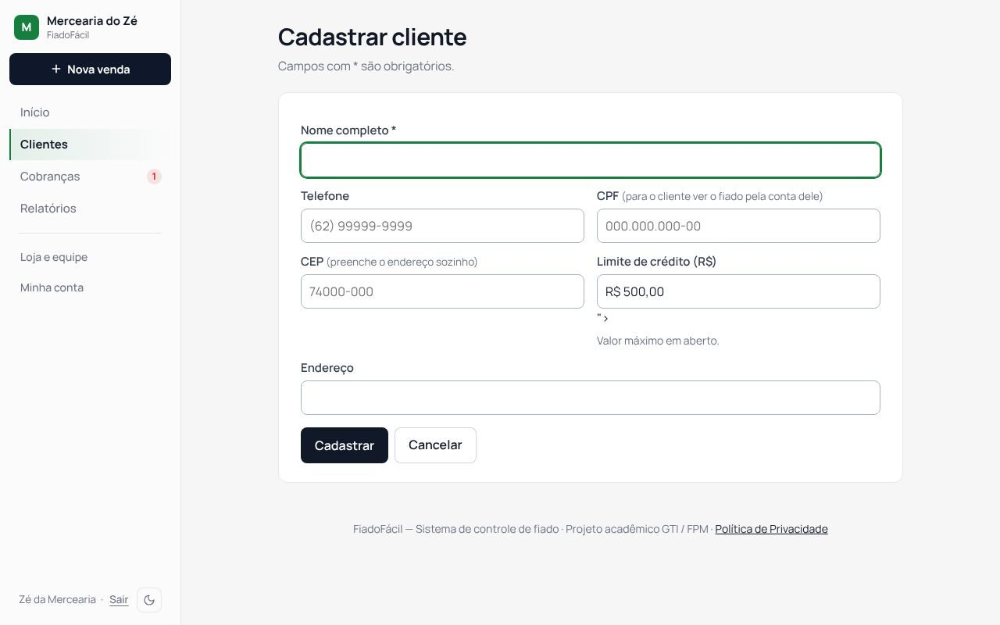

### Extrato do cliente
Mostra a dívida atual, o limite, o limite disponível, a barra de uso do limite e as listas de compras e pagamentos. Botões: **Registrar compra**, **Registrar pagamento**, **Cobrar no WhatsApp** (quando há dívida e telefone) e **Editar**.

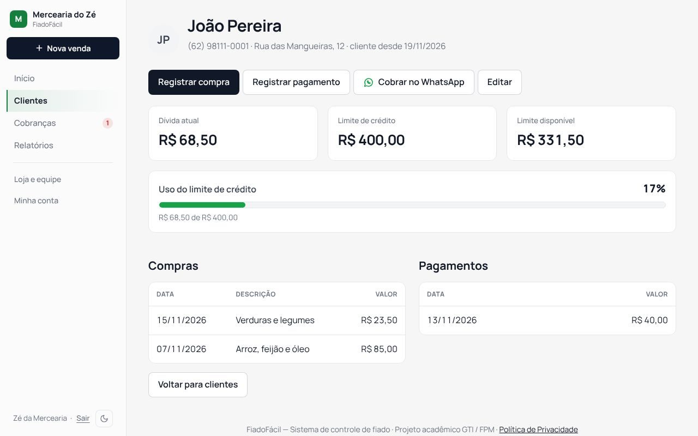

**Cobrar no WhatsApp:** abre a conversa com a mensagem pronta, com o valor e a chave Pix da loja. Nada é enviado sem você apertar "enviar".

### Nova venda
No topo do menu, o botão **Nova venda** abre duas opções: **Registrar compra** (o cliente levou no fiado) e **Registrar pagamento** (o cliente pagou).

### Registrar compra
Escolha o cliente (a lista mostra quanto cada um ainda tem disponível), descreva a compra (opcional) e digite o valor: digite só os números e o campo mostra sozinho "R$ 0,00". Antes de gravar, aparece uma janela com o resumo (cliente, valor, dívida antes e depois) para confirmar. Quem abriu a compra pelo extrato do cliente volta para o extrato depois de salvar ou cancelar. Se a compra passar do limite, o sistema **recusa** e mostra o limite, a dívida e o disponível.

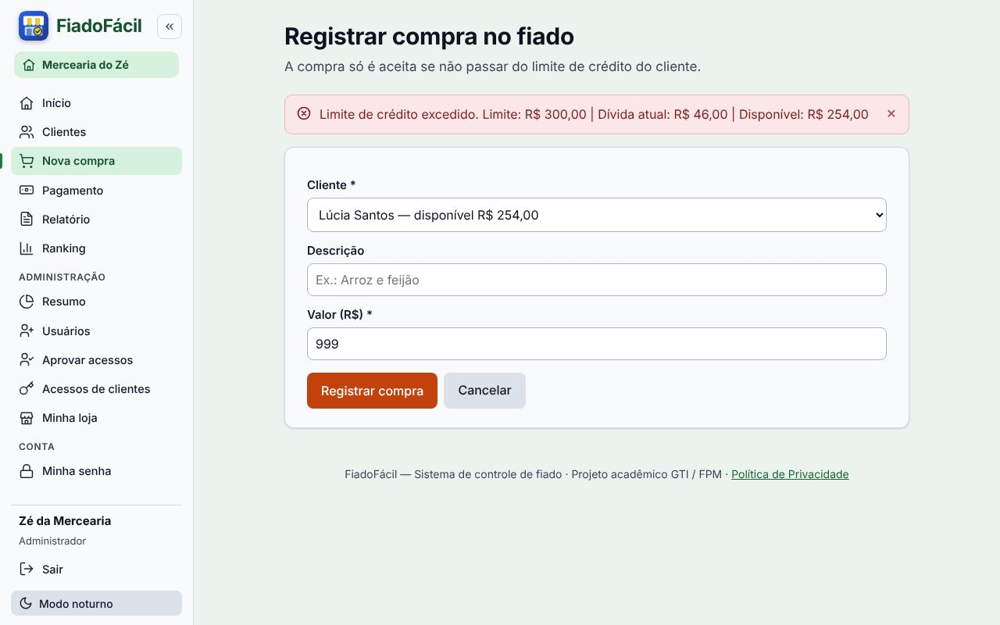

### Registrar pagamento
Escolha o cliente (só aparecem os que devem) e digite o valor, ou clique em **"Quitar dívida inteira"**. Não é possível pagar mais do que a dívida. O pagamento abate as compras mais antigas primeiro.

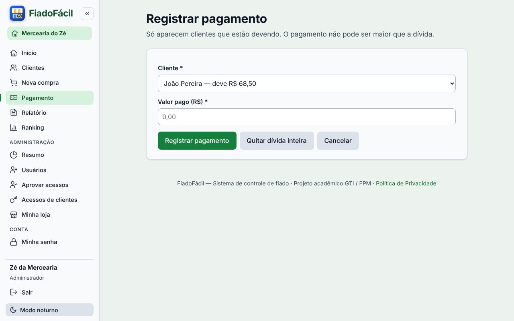

### Cobranças
No menu **Cobranças** (com um número quando há alguém para cobrar), aparecem duas listas:
- **Vencem nos próximos 3 dias:** quem ainda está em dia, mas vira inadimplente em breve. Um lembrete gentil antes do atraso.
- **Em atraso:** quem passou de 30 dias.

Em cada cliente: **Enviar no WhatsApp** (abre a conversa com a mensagem pronta e organizada: valor, prazo e chave Pix) e **Ver mensagem**, com o botão para copiar. Na tela inicial, o aviso **"Hora de cobrar"** leva direto para cá.

### Relatórios
No menu **Relatórios**, as abas no topo levam ao **Relatório de dívidas**, ao **Ranking** e, para o administrador, ao **Resumo financeiro**.

### Relatório de dívidas
Filtre por **período** (de/até) e **situação** (todas, devendo, inadimplente ou em dia). Mostra compras e pagamentos no período, saldo devedor, dias em aberto e situação. Use **Imprimir** para uma versão limpa em papel ou PDF.

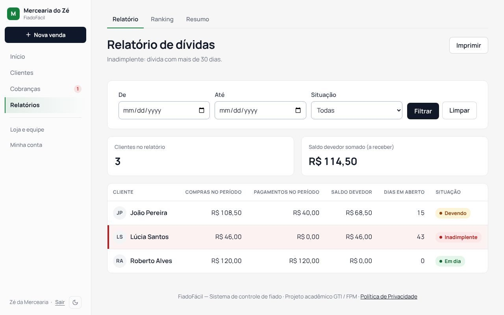

### Ranking de confiabilidade
Ordena os clientes pelo score de 0 a 100: **80 ou mais** confiável, **50 a 79** regular, **abaixo de 50** risco. O score cai com os dias em atraso e com a dívida alta, e sobe com pagamentos feitos.

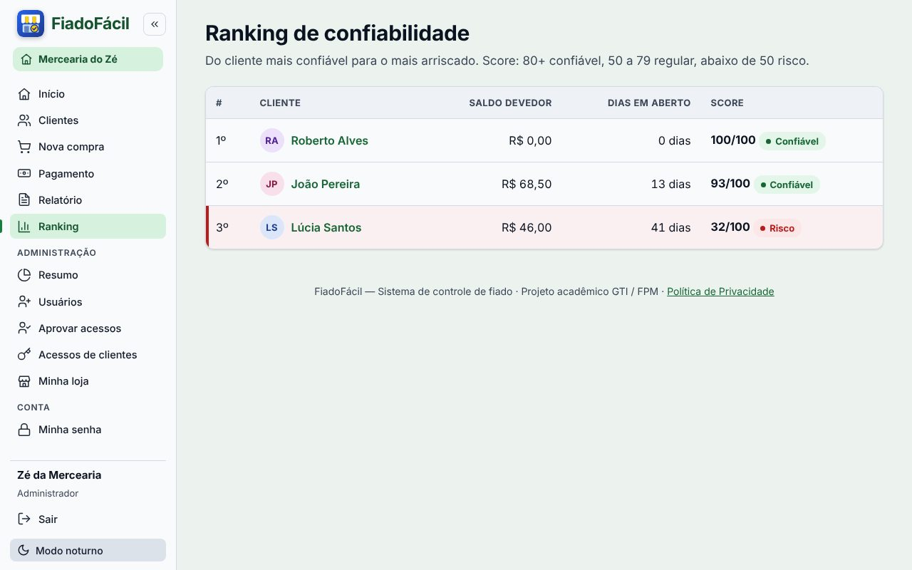

### Minha conta
No menu **Minha conta**: troque entre **modo claro e noturno** e troque a senha (informe a atual e a nova, com no mínimo 8 caracteres).

---

## Somente o administrador

Tudo fica no menu **Loja e equipe**, com abas no topo: **Minha loja**, **Usuários**, **Aprovar acessos** e **Acessos de clientes**. Quando há pedidos esperando aprovação, aparece um número ao lado de "Loja e equipe".

### Resumo financeiro
Clientes, devedores, inadimplentes, total a receber, total já recebido, total vendido no fiado, ticket médio e dívida média, mais a lista dos **maiores devedores**.

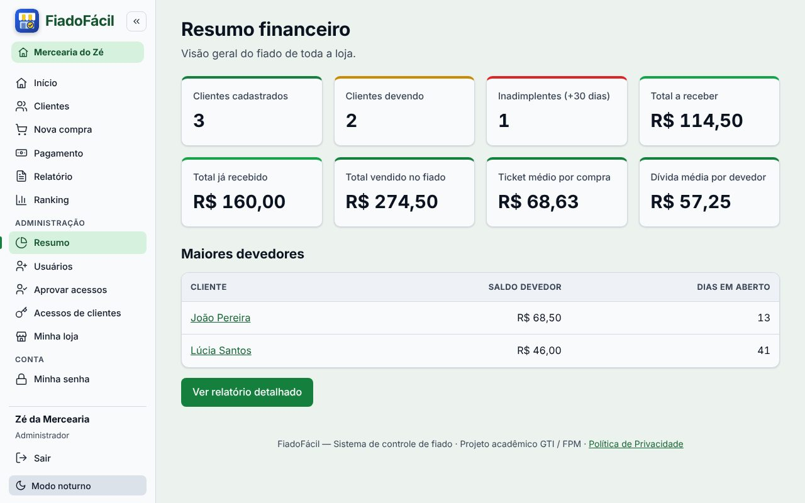

### Usuários (funcionários)
Crie usuários **administrador** ou **comum (atendente)**, com senha de no mínimo 8 caracteres. Em cada um: **Bloquear**, **Desbloquear** e **Trocar senha**. Um usuário bloqueado sai do sistema no clique seguinte.

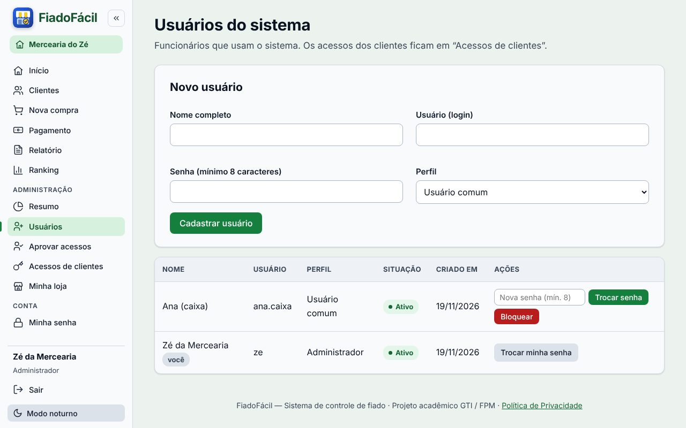

### Aprovar acessos
Dois tipos de pedido aparecem aqui (o número ao lado de "Loja e equipe" e da aba mostra quantos estão esperando):
1. **Pedidos de acesso por usuário** (feitos em "Sou cliente" pelo jeito antigo): escolha a qual cliente o pedido pertence (o sistema sugere pelo telefone) e clique em **Aprovar** ou **Recusar**.
2. **Contas de clientes por CPF:** o cliente criou a conta com o CPF que está no cadastro. Confira o nome e se o telefone **confere**, e clique em **Confirmar** ou **Recusar**. As contas já confirmadas podem ser **desligadas**.

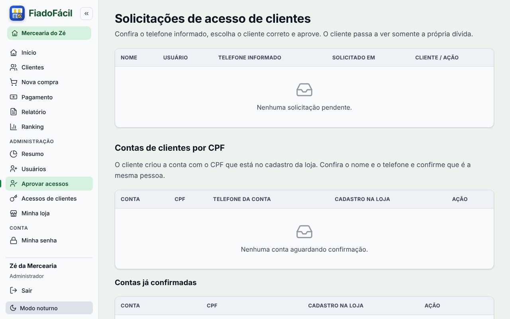

### Acessos de clientes
Lista os acessos de cliente por usuário, com **Bloquear**, **Desbloquear** e **Trocar senha**.

### Minha loja
- **Foto da loja:** escolha uma foto deitada (JPG, PNG ou WEBP, até 6 MB). Ela aparece no fundo da tela de entrar, escurecida, com o nome da loja por cima. As lojas de exemplo já vêm com foto; dá para trocar ou remover.
- **Receber pelo Pix:** cadastre a chave Pix e a cidade. O cliente passa a ver um QR Code com o valor da dívida. Use **"Ver um Pix de teste"** para conferir no app do banco se o nome do recebedor está certo.
- **Cobrar pelo WhatsApp:** já vem ligado.
- **API da loja:** gere uma chave para outro programa ler os dados da loja. A chave aparece **uma vez só**; copie e guarde. Dá para gerar outra ou desligar. Veja [API.md](API.md).

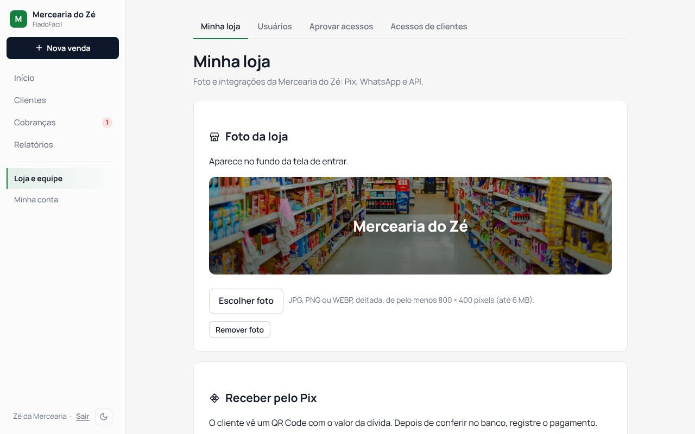

### Excluir cliente
Na lista de clientes, botão de lixeira. Só funciona se o cliente **não estiver devendo**. A exclusão apaga o histórico e os acessos dele.

---

## Cliente

### Conta única com CPF (recomendado)
Com uma conta só, o cliente vê o fiado de **todas** as lojas onde compra.

**Criar a conta**
1. Peça para a loja incluir o seu **CPF** no seu cadastro.
2. No site, clique em **Entrar → "Sou cliente"** → **"Ainda não tenho conta: criar agora"**.
3. Preencha nome, CPF, o **mesmo telefone que a loja tem** e uma senha (mínimo de 8 caracteres).
4. Cada loja confirma que é você. Enquanto isso, ela aparece como "Aguardando a loja confirmar".

**Entrar e ver as dívidas**
Entre com **CPF e senha**. A tela **Minhas dívidas** mostra o total que você deve e um cartão por loja, com:
- quanto deve, o limite e o disponível;
- **Pagar com Pix:** QR Code com o valor já preenchido e o botão "Copiar código";
- **Últimas compras e pagamentos**.

No fim da tela há **"Trocar minha senha"**.

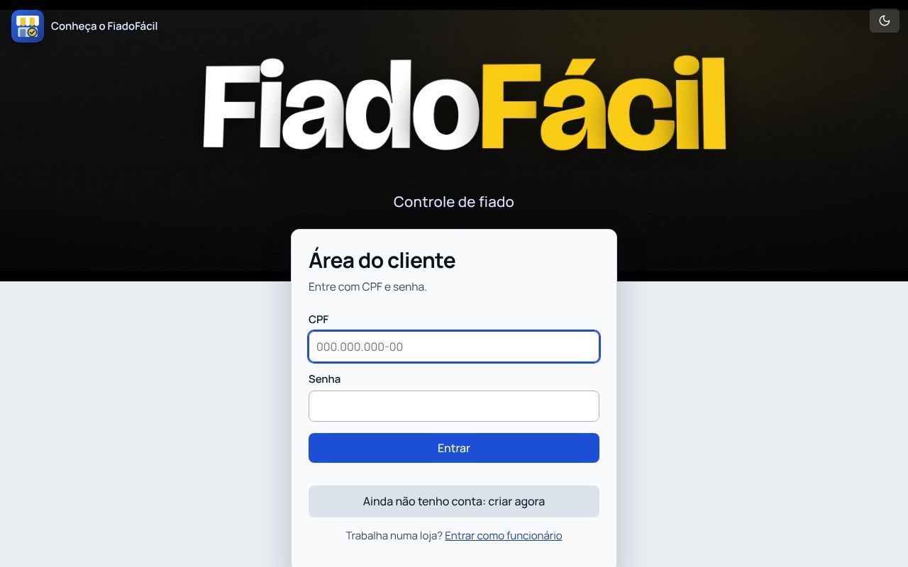

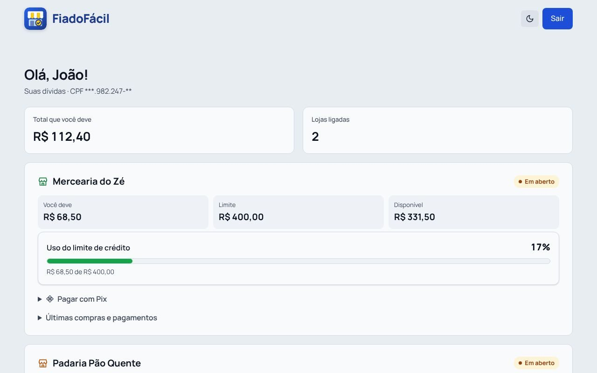

> O pagamento pelo Pix aparece depois que a loja confere e registra. Cada loja só vê os próprios dados: a Mercearia não sabe quanto você deve na Padaria.

### Acesso por usuário numa loja (jeito antigo)
Continua funcionando para quem já usava. O pedido fica no endereço `fiadofacil.free.je/solicitar_acesso.php?loja=nome-da-loja`, onde o cliente informa nome, telefone, usuário e senha. Depois que o administrador aprova, ele entra pelo login da loja e vê a dívida daquela loja.

---

## Dono da plataforma

Endereço: `fiadofacil.free.je/painel.php` (login próprio).

- Vê todas as lojas com o número de clientes, funcionários, acessos e o total a receber.
- **Criar nova loja:** nome, endereço (opcional; é criado a partir do nome) e o administrador da loja.
- **Bloquear / Desbloquear:** com a loja bloqueada, ninguém dela entra.
- **Entrar como administrador:** abre a loja com uma faixa no topo; **"Voltar ao painel"** sai dela.

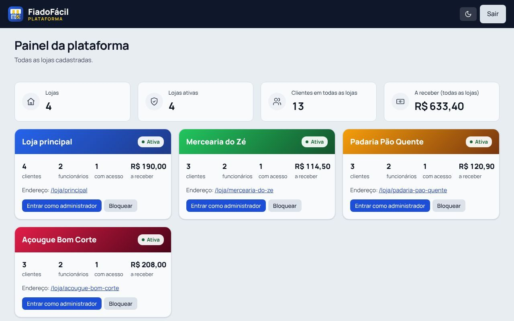

---

## No celular

O sistema funciona no navegador do celular: o menu vira o botão **☰ Menu** e as tabelas viram cartões. Em **Minha conta** você troca entre **modo claro e noturno**. Para usar como aplicativo, abra o menu do navegador e escolha **"Adicionar à tela inicial"**.

| Loja no modo noturno | Cliente no celular |
|---|---|
| 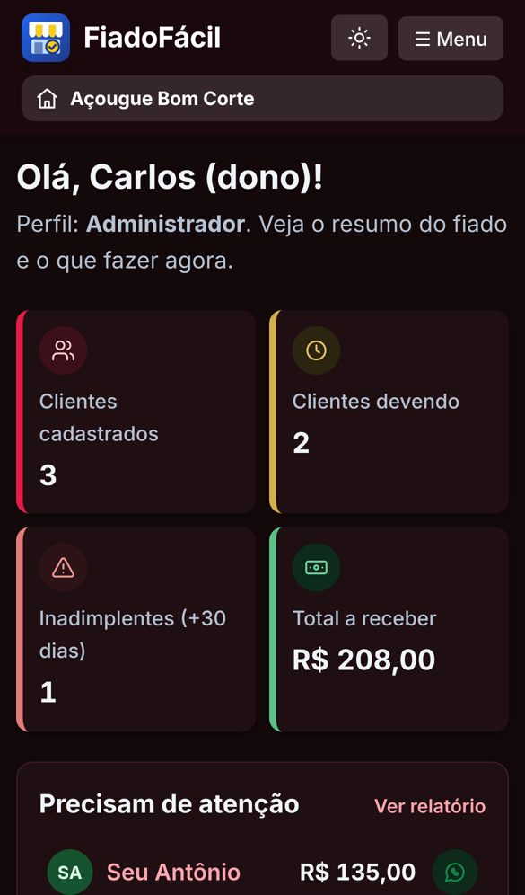 | 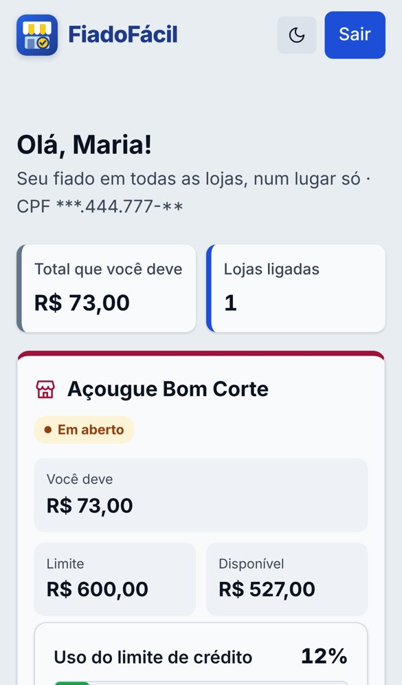 |

---

## Perguntas frequentes

**Esqueci a senha.** Funcionário: peça ao administrador ("Trocar senha" em Usuários). Cliente com acesso por usuário: peça à loja ("Acessos de clientes"). A recuperação por e-mail ainda não existe.

**Não consigo lançar uma compra.** O valor passaria do limite do cliente. O administrador pode aumentar o limite em "Editar".

**O endereço da loja deu "página não encontrada".** Confira o nome ou use **Entrar** e digite o nome da loja.

**O cliente pagou pelo Pix e a dívida não baixou.** O Pix cai direto na conta da loja; confira no banco e lance em **Registrar pagamento**.

**O cliente não vê uma loja na conta dele.** A loja precisa ter o CPF dele no cadastro e confirmar em **Aprovar acessos**.
