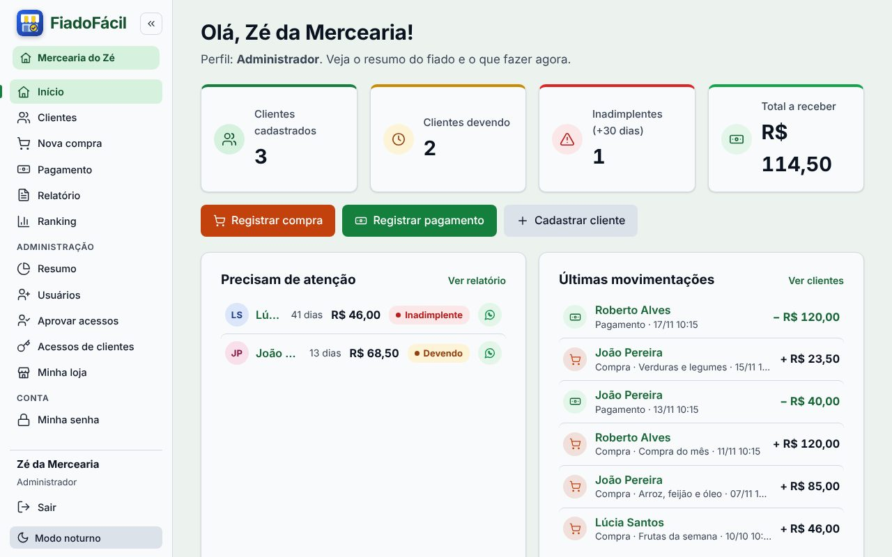

# Documentação do FiadoFácil

Sistema web para pequenos comércios controlarem as vendas no fiado: limite de crédito por cliente, compras, pagamentos, quem está devendo e quem está atrasado. Atende várias lojas na mesma plataforma, e o cliente acompanha as dívidas de todas as lojas numa conta só.

- **Site no ar:** https://fiadofacil.free.je
- **Autor:** Matheus Wilton, responsável por todo o sistema (regras de negócio, desenvolvimento e banco de dados)
- **Contexto:** Projeto Integrador do curso de Gestão da Tecnologia da Informação da FPM, Goiânia/GO

## Por onde começar

| Quero... | Documento |
|---|---|
| Entender o sistema por dentro (requisitos, regras, banco, segurança, instalação) | [Documentação técnica](DOCUMENTACAO_TECNICA.md) |
| Aprender a usar, tela por tela | [Manual do usuário](MANUAL_DO_USUARIO.md) |
| Ligar outro programa ao FiadoFácil | [Referência da API](API.md) |
| Ver os diagramas (banco, casos de uso, fluxos, arquitetura) | [Diagramas](DIAGRAMAS.md) |
| Ver o problema, os requisitos e o resultado num exemplo real | [Case](CASE.md) |
| Apresentar o projeto (dados, fontes e roteiro) | [Pitch](PITCH.md) |
| Fazer a demonstração ao vivo | [Roteiro da demonstração](APRESENTACAO.md) |

## Resumo em uma página

| | |
|---|---|
| **Problema** | O fiado do comércio de bairro é anotado num caderno: sem limite, sem saber quem está atrasado e com risco de perder tudo. |
| **Solução** | Sistema web que bloqueia compras acima do limite, abate os pagamentos da compra mais antiga e mostra sozinho quem está inadimplente. |
| **Quem usa** | Dono da loja (administrador), atendente, cliente e o dono da plataforma. |
| **Tecnologias** | PHP 8, MySQL/MariaDB, HTML, CSS e JavaScript puros, Git, GitHub Actions e hospedagem InfinityFree. |
| **Destaques** | Várias lojas isoladas no mesmo banco, conta única do cliente por CPF, Pix com QR Code, cobrança pelo WhatsApp, API REST, versão para celular e modo noturno. |
| **Segurança** | Prepared statements, senhas com bcrypt, proteção contra CSRF, XSS e IDOR, HTTPS, limite de tentativas de login. |

## Imagens

- [`img/`](img/): diagramas em PNG para os slides.
- [`img/telas/`](img/telas/): fotos das telas do sistema.
